# PV Assistant

[-blue)](https://github.com/weskona/pv-assistant/wiki)

[English](#english) · [Deutsch](#deutsch)

Full documentation / Ausführliche Dokumentation: **[Wiki](https://github.com/weskona/pv-assistant/wiki)** (English and German, sources in [`wiki/`](wiki)). Bugs and ideas / Fehler und Wünsche: **[Issue tracker](https://github.com/weskona/pv-assistant/issues/new/choose)**.

## English

Home Assistant integration with its own sidebar panel for the PV energy flow: production, feed-in, grid import, storage, house consumption and forecast, with analyses per string.

> **Beta:** The integration is in beta. Features and settings may still change and there may be bugs. All releases are marked as pre-releases and carry the suffix `-beta` (for example `v0.6.4-beta`); in HACS enable "Show beta versions" or choose the version by hand when downloading. Please report feedback as an issue.

### Installation
1. Add the repository in HACS as a custom repository (type **Integration**) or copy the folder `custom_components/pv_assistant` to `config/custom_components/`.
2. Restart Home Assistant.
3. Settings → Devices & services → Add integration → **PV Assistant**.
4. Choose the sensors. After an update restart Home Assistant and reload the browser.

### Setup in four steps
1. **Energy sensors (kWh):** production (several), feed-in (one), optional storage in / out / combined (several, combined sensors with switchable sign, default positive = from storage).
2. **Power sensors (W):** same layout; switches for negative feed-in and negative storage values. With differently oriented strings use one sensor per string, not a total sensor.
3. **Forecast (optional):** energy sensors for today, tomorrow and rest of today (for example Forecast.Solar or Solcast).
4. **Grid, consumption and prices (optional):** grid import, house consumption (including wallbox, heat pump etc.), battery level, battery health (SoH), irradiance, electricity price and feed-in tariff (sensor or `input_number`).

### The panel
| Tab | Content |
|---|---|
| Now | live energy flow diagram (solar, home, grid, storage), current values and sums of all sensors and the forecast |
| Power | power per string against its peak, whole plant, power chart per string |
| Plants | table of the plants, typical day, power duration curve with the inverter limit, yield by time of day (shading), yield per month, heat map month × hour |
| Analysis | plant comparison (kWh/kWp per inverter, corrected for orientation and tilt, with suggestions), yield per plant and month, estimated curtailment, possible shading, heat map, best and weakest days, power plateaus, performance ratio |
| History | power, effective power and energy charts for today up to 12 months, key figures such as autarky, self-consumption, savings, CO₂ |
| Balance | use of the PV production and coverage of the consumption as stacked bars, self-sufficiency and self-consumption per day or month |
| Consumption | base load, working days against weekends, consumption and grid import by time of day, highest grid import |
| Storage | level, storage power, charged and discharged energy, efficiency, storage benefit and losses, cycles, usable capacity, health (SoH, estimated capacity, idle loss) |
| Forecast | forecast vs actual per day or month, deviation, hit rate, best time for large consumers, quality by forecast size |
| Economics | benefit per month, cumulative benefit against the plant cost with payback date, storage benefit |
| Yearly overview | monthly production against the average, year forecast, change against last year, benefit, payback, trend, hint on degradation |
| Scenarios | calculator for what is new: an additional storage (own capacity and efficiency), more PV, an extra consumption (wallbox, heat pump): extra benefit against today, payback, recommendation, matrix, saved scenarios |
| Settings | plants (inverters) with their sensors; display names, peak, MPPTs and module strings (modules, orientation, tilt) per sensor, plant values (capacity, minimum level, prices, cost, CO₂ factor, location) |

The data comes from the long-term statistics of Home Assistant (recorder); the sensors therefore need a `state_class`. The integration also creates filtered copies of the energy sensors (`… filtered`, ignore short drops, usable as `utility_meter` source) a binary sensor `binary_sensor.pv_assistant_string_fault` ("Plant fault") that reports a plant delivering almost nothing while the others produce, and calculated sensors for automations and dashboards: PV power and effective power (whole system and per plant), production, feed-in, self-consumption rate, self-sufficiency, savings and benefit of the day, usable energy of the storage and the share of the forecast reached (see the wiki, Entities and services). Settings are stored in `.storage/pv_assistant.settings` and apply to all devices; only administrators can save.

### Screenshots
Sample data, click an image for the full size (the images are created with `tools/screenshots`).

<table>
<tr><td align="center"><a href="docs/screenshots/en/01-now.png">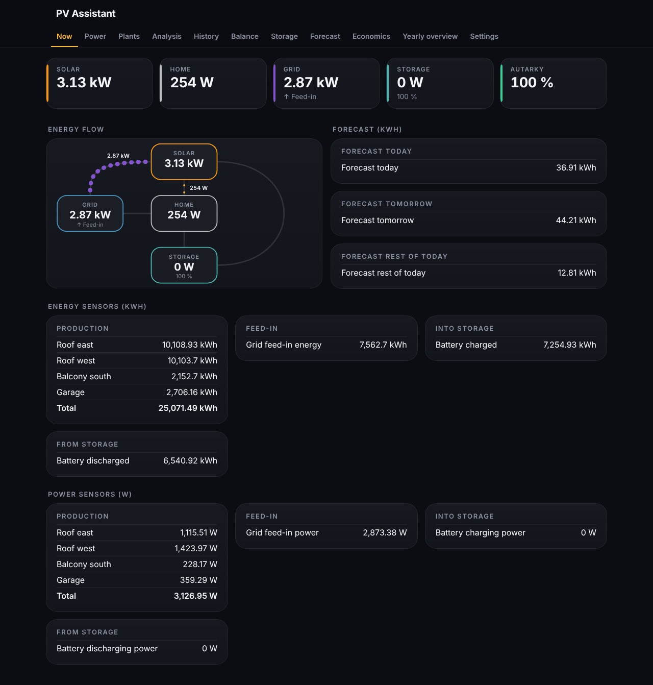</a> Now</td><td align="center"><a href="docs/screenshots/en/02-power.png">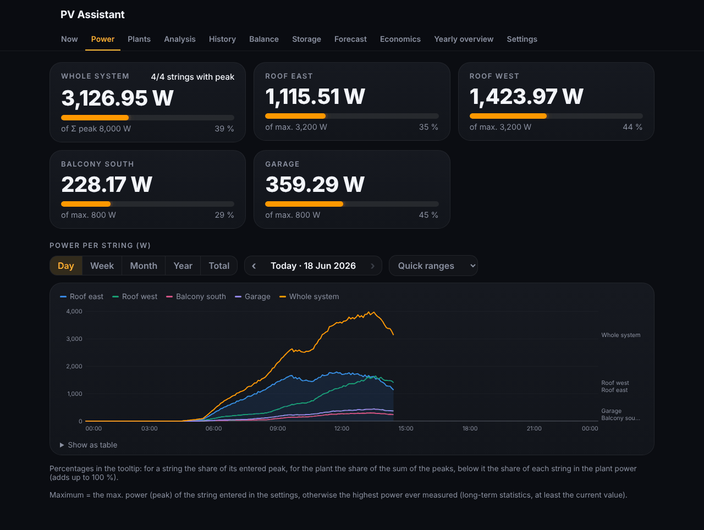</a> Power</td><td align="center"><a href="docs/screenshots/en/03-plants.png">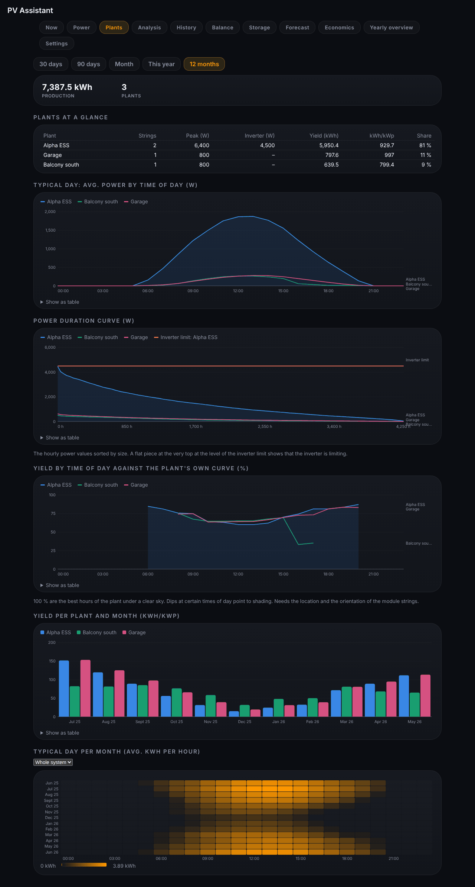</a> Plants</td></tr>
<tr><td align="center"><a href="docs/screenshots/en/04-analysis.png">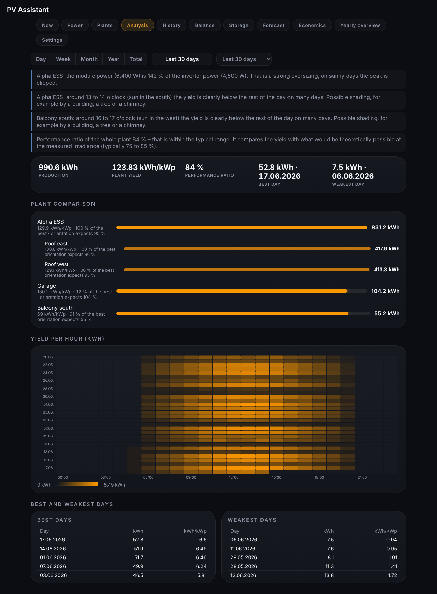</a> Analysis</td><td align="center"><a href="docs/screenshots/en/05-history.png">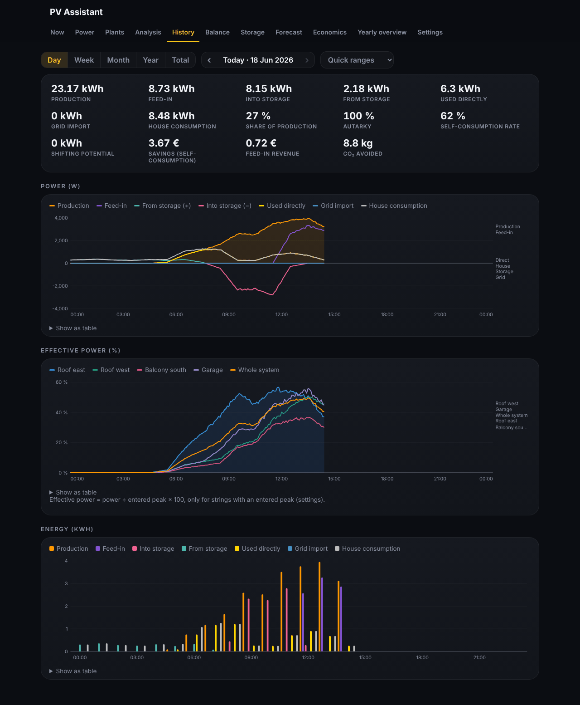</a> History</td><td align="center"><a href="docs/screenshots/en/06-balance.png">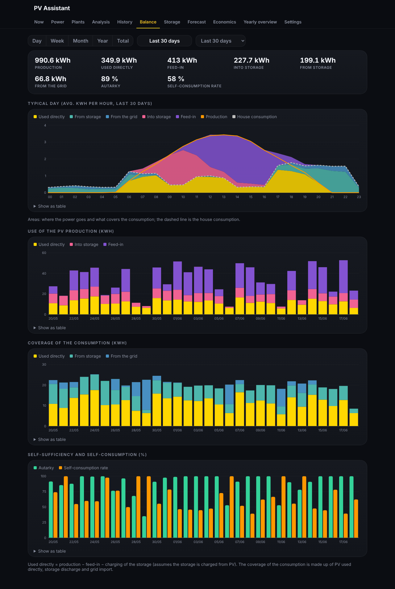</a> Balance</td></tr>
<tr><td align="center"><a href="docs/screenshots/en/08-storage.png">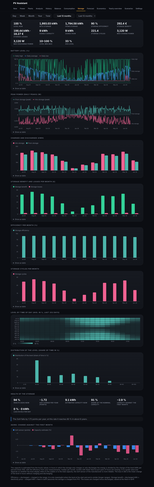</a> Storage</td><td align="center"><a href="docs/screenshots/en/09-forecast.png">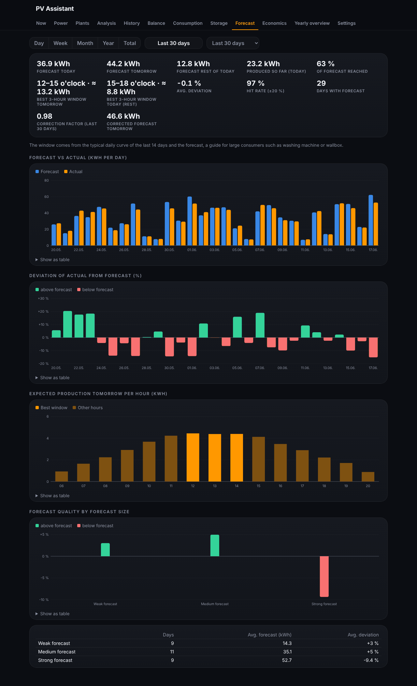</a> Forecast</td><td align="center"><a href="docs/screenshots/en/10-economics.png">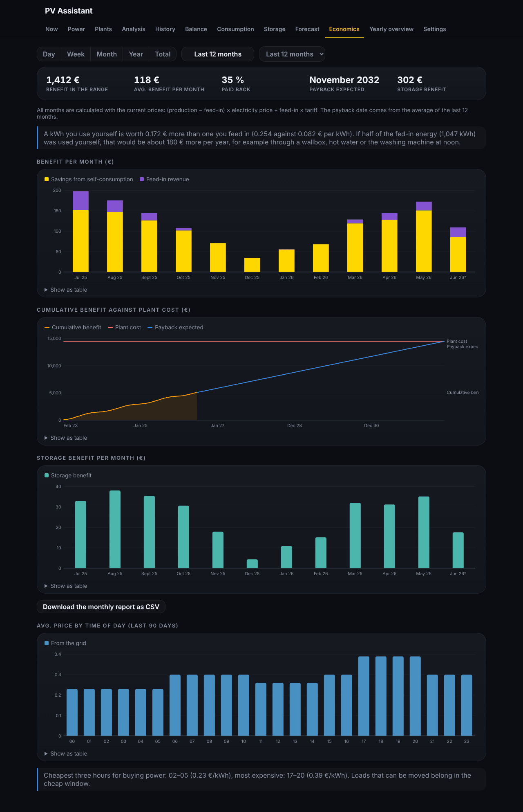</a> Economics</td></tr>
<tr><td align="center"><a href="docs/screenshots/en/11-yearly.png">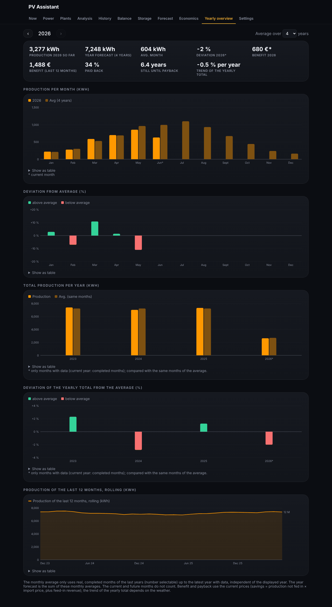</a> Yearly overview</td><td align="center"><a href="docs/screenshots/en/13-settings.png">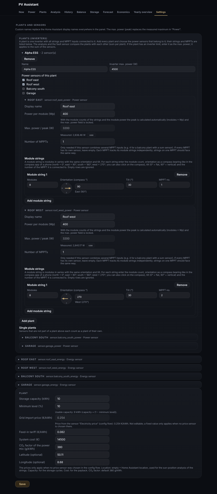</a> Settings</td></tr>
</table>

### Known limitations
- Directly used PV: if the storage also charges from the grid the value is a little too low (without a grid import sensor). For hourly values (7/30 days) Home Assistant averages signed power sensors, so there the value is an approximation.
- The colors "yellow on a light background" and "pink/turquoise for red-green color weakness" are hard to tell apart (legend, tooltip and table as compensation).
- The thresholds of hints and of the plant fault sensor are heuristics, not a diagnosis.

## Deutsch

Home-Assistant-Integration mit eigenem Sidebar-Panel für den PV-Energiefluss: Erzeugung, Einspeisung, Netzbezug, Speicher, Hausverbrauch und Prognose, mit Auswertungen pro String.

> **Beta:** Die Integration befindet sich im Beta-Status. Funktionen und Einstellungen können sich noch ändern, und es kann Fehler geben. Alle Releases sind als Vorabversion (Pre-release) markiert und tragen das Suffix `-beta` (z. B. `v0.6.4-beta`); in HACS dafür „Beta-Versionen anzeigen“ aktivieren oder die Version beim Herunterladen von Hand wählen. Rückmeldungen bitte als Issue melden.

### Installation
1. Das Repository in HACS als benutzerdefiniertes Repository (Typ **Integration**) hinzufügen oder den Ordner `custom_components/pv_assistant` nach `config/custom_components/` kopieren.
2. Home Assistant neu starten.
3. Einstellungen → Geräte & Dienste → Integration hinzufügen → **PV Assistant**.
4. Sensoren auswählen. Nach einem Update Home Assistant neu starten und den Browser neu laden.

### Einrichtung in vier Schritten
1. **Energiesensoren (kWh):** Erzeugung (mehrere), Einspeisung (einer), optional Speicher rein / raus / kombiniert (mehrere, Kombisensoren mit umschaltbarem Vorzeichen, Standard positiv = aus Speicher).
2. **Leistungssensoren (W):** gleicher Aufbau; Schalter für negative Einspeisung und negative Speicherwerte. Bei verschieden ausgerichteten Strings je String einen Sensor verwenden, keinen Gesamtsensor.
3. **Prognose (optional):** Energiesensoren für heute, morgen und Rest heute (z. B. Forecast.Solar oder Solcast).
4. **Netz, Verbrauch und Preise (optional):** Netzbezug, Hausverbrauch (inkl. Wallbox, Wärmepumpe usw.), Batterie-Ladestand, Batteriegesundheit (SoH), Einstrahlung, Strompreis und Einspeisevergütung (Sensor oder `input_number`).

### Das Panel
| Tab | Inhalt |
|---|---|
| Aktuell | Live-Energiefluss (PV, Haus, Netz, Speicher), aktuelle Werte und Summen aller Sensoren und der Prognose |
| Leistung | Leistung je String im Verhältnis zum Peak, Gesamtanlage, Leistungsdiagramm je String |
| Anlagen | Tabelle der Anlagen, typischer Tag, Leistungsdauerlinie mit Wechselrichter-Grenze, Ertrag nach Uhrzeit (Verschattung), Ertrag je Monat, Heatmap Monat × Stunde |
| Analyse | Anlagen-Vergleich (kWh/kWp je Wechselrichter, bereinigt um Ausrichtung und Neigung, mit Vorschlägen), Ertrag je Anlage und Monat, geschätzte Abregelung, mögliche Verschattung, Heatmap, beste und schwächste Tage, Leistungs-Plateaus, Performance Ratio |
| Verlauf | Leistungs-, Effektivleistungs- und Energiediagramme von heute bis 12 Monate, Kennzahlen wie Autarkie, Eigenverbrauch, Ersparnis, CO₂ |
| Energiebilanz | Verwendung der PV-Erzeugung und Deckung des Verbrauchs als gestapelte Balken, Autarkie und Eigenverbrauch je Tag oder Monat |
| Verbrauch | Grundlast, Werktage gegen Wochenende, Verbrauch und Netzbezug nach Uhrzeit, höchster Netzbezug |
| Speicher | Ladestand, Speicherleistung, geladene und entladene Energie, Wirkungsgrad, Speicher-Nutzen und -Verluste, Zyklen, nutzbare Kapazität, Gesundheit (SoH, geschätzte Kapazität, Verlust im Leerlauf) |
| Prognose | Prognose gegen Ist je Tag oder Monat, Abweichung, Trefferquote, beste Zeit für Großverbraucher, Güte nach Prognosegröße |
| Wirtschaft | Nutzen je Monat, kumulierter Nutzen gegen die Anlagenkosten mit Amortisationsdatum, Speicher-Nutzen |
| Jahresübersicht | Monatserzeugung gegen den Schnitt, Jahresprognose, Veränderung zum Vorjahr, Nutzen, Amortisation, Trend, Hinweis auf Degradation |
| Szenarien | Rechner für das Neue: ein zusätzlicher Speicher (eigene Kapazität und Wirkungsgrad), mehr PV, ein Zusatzverbrauch (Wallbox, Wärmepumpe): Zusatznutzen gegenüber heute, Amortisation, Empfehlung, Matrix, gespeicherte Szenarien |
| Einstellungen | Anlagen (Wechselrichter) mit ihren Sensoren; Anzeigenamen, Peak, MPPTs und Modulstränge (Module, Ausrichtung, Neigung) je Sensor, Anlagenwerte (Kapazität, Mindest-Ladestand, Preise, Kosten, CO₂-Faktor, Standort) |

Die Daten kommen aus den Langzeitstatistiken von Home Assistant (Recorder); die Sensoren brauchen daher eine `state_class`. Die Integration legt außerdem bereinigte Kopien der Energiesensoren an (`… bereinigt`, ignorieren kurze Abstürze, als Quelle für `utility_meter` nutzbar) einen Binärsensor `binary_sensor.pv_assistant_string_fault` („Anlagen-Störung“), der meldet, wenn eine Anlage fast nichts liefert, während die anderen erzeugen, und berechnete Sensoren für Automationen und Dashboards: PV-Leistung und effektive Leistung (Gesamtsystem und je Anlage), Erzeugung, Einspeisung, Eigenverbrauchsquote, Autarkie, Ersparnis und Nutzen des Tages, nutzbare Energie des Speichers und der erreichte Anteil der Prognose (siehe Wiki, Entitäten und Dienste). Die Einstellungen liegen in `.storage/pv_assistant.settings` und gelten für alle Geräte; nur Administratoren dürfen speichern.

### Screenshots
Beispieldaten, ein Klick auf ein Bild zeigt die volle Größe (die Bilder entstehen mit `tools/screenshots`).

<table>
<tr><td align="center"><a href="docs/screenshots/de/01-now.png">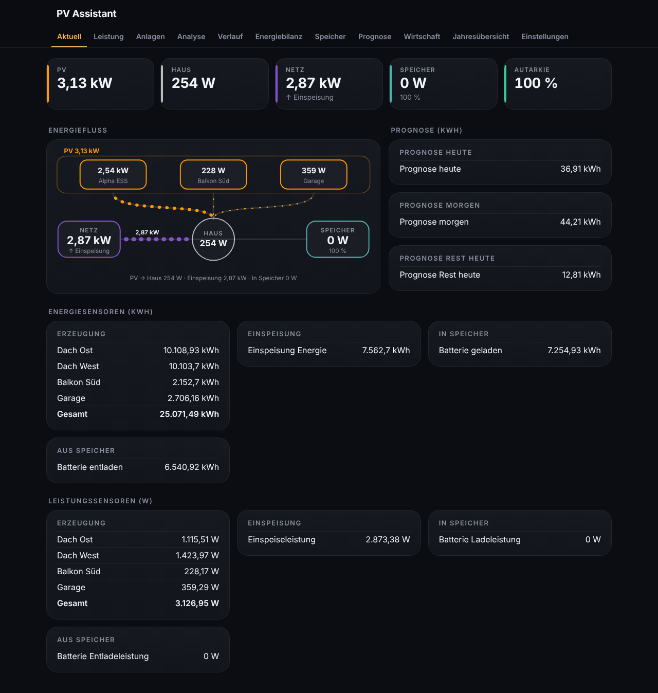</a> Aktuell</td><td align="center"><a href="docs/screenshots/de/02-power.png">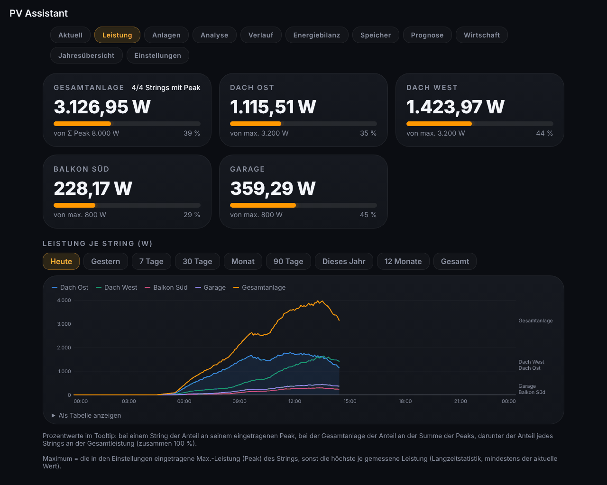</a> Leistung</td><td align="center"><a href="docs/screenshots/de/03-plants.png">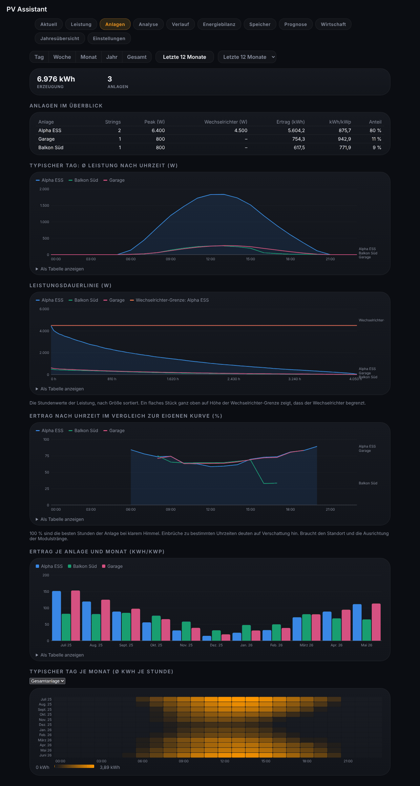</a> Anlagen</td></tr>
<tr><td align="center"><a href="docs/screenshots/de/04-analysis.png">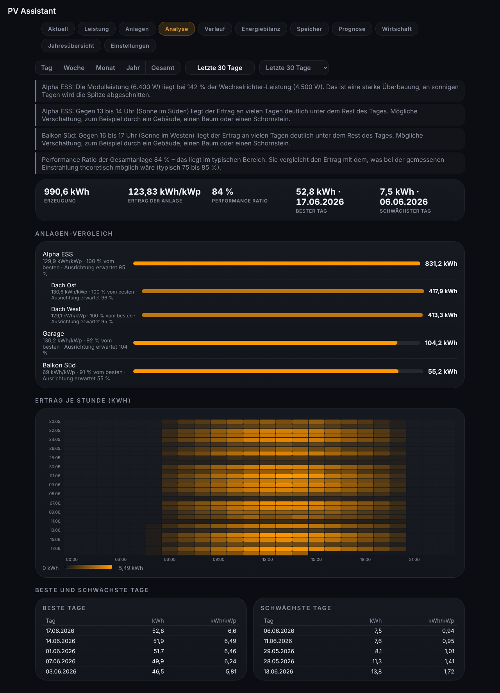</a> Analyse</td><td align="center"><a href="docs/screenshots/de/05-history.png">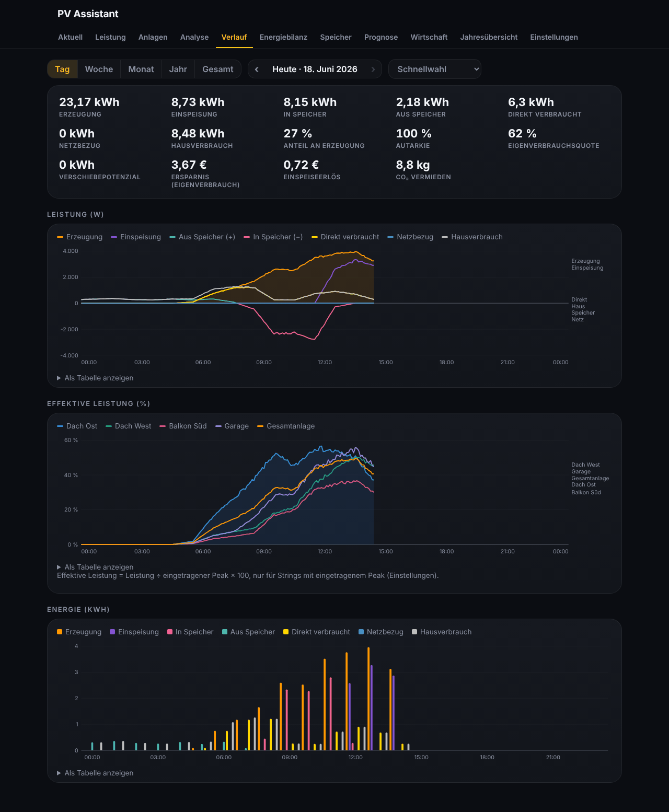</a> Verlauf</td><td align="center"><a href="docs/screenshots/de/06-balance.png">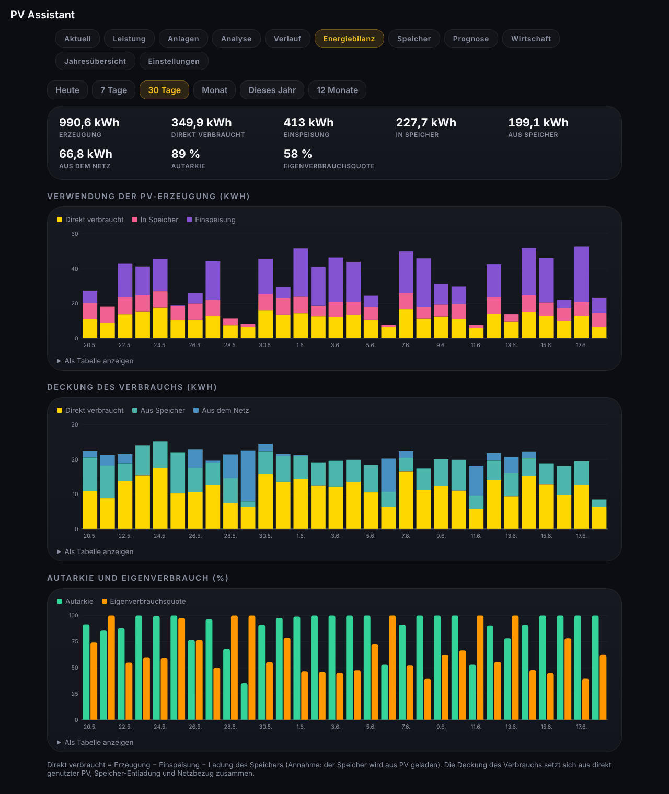</a> Energiebilanz</td></tr>
<tr><td align="center"><a href="docs/screenshots/de/08-storage.png">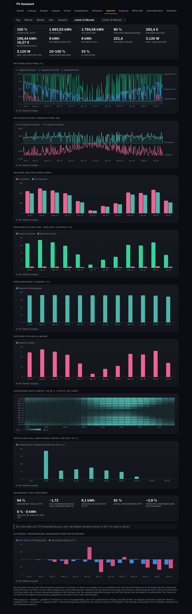</a> Speicher</td><td align="center"><a href="docs/screenshots/de/09-forecast.png">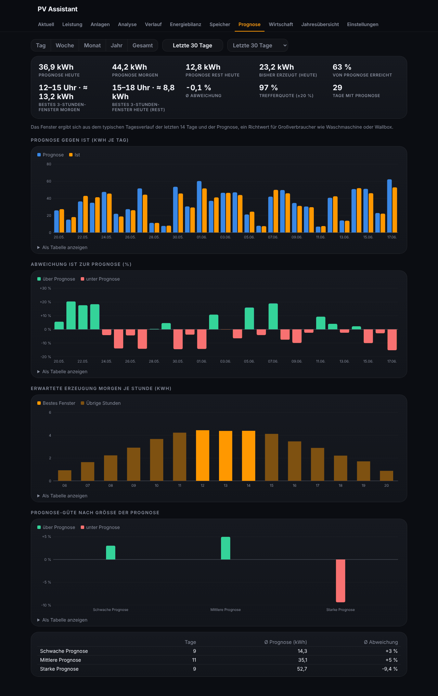</a> Prognose</td><td align="center"><a href="docs/screenshots/de/10-economics.png">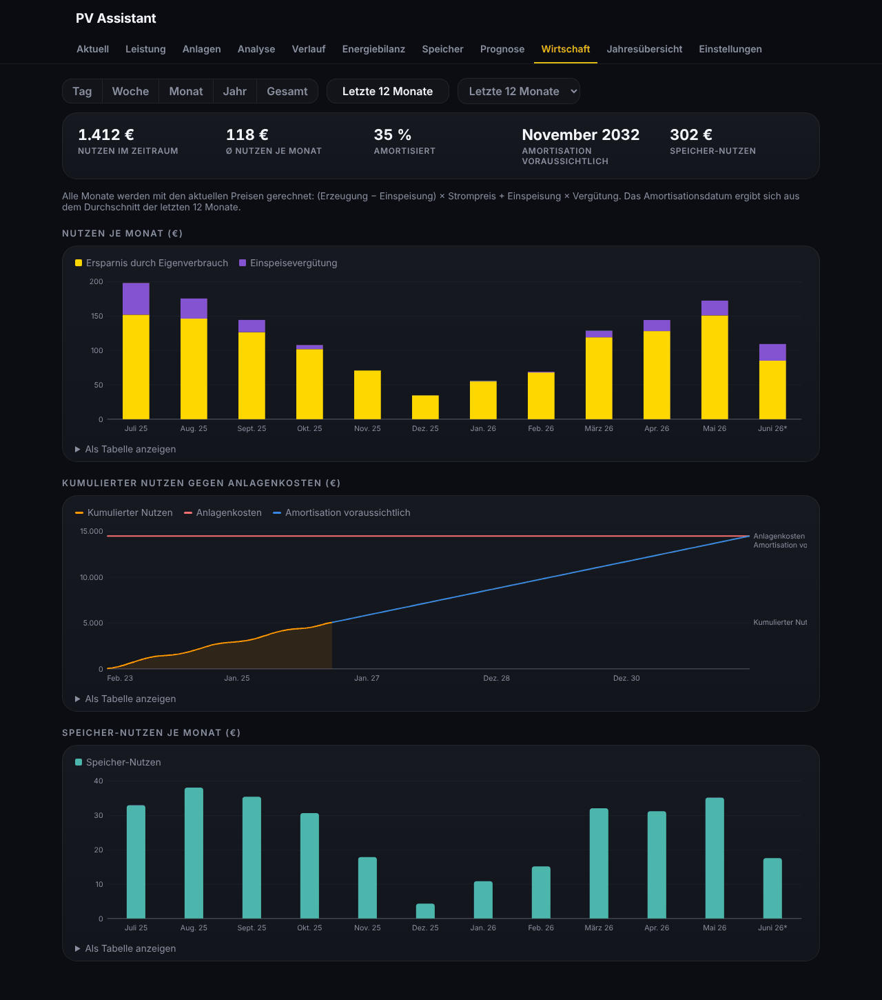</a> Wirtschaft</td></tr>
<tr><td align="center"><a href="docs/screenshots/de/11-yearly.png">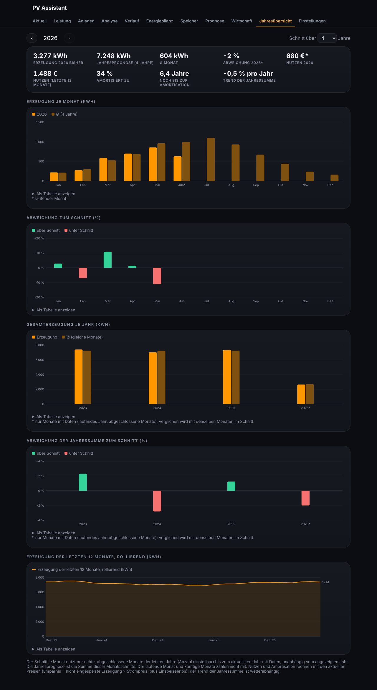</a> Jahresübersicht</td><td align="center"><a href="docs/screenshots/de/13-settings.png">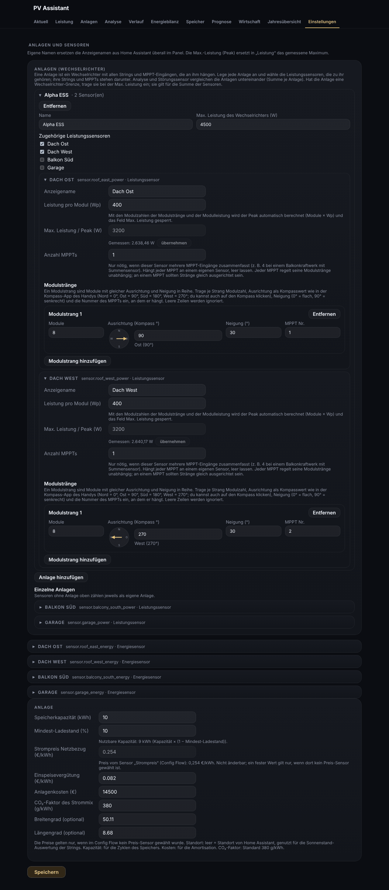</a> Einstellungen</td></tr>
</table>

### Bekannte Einschränkungen
- Direkt verbrauchte PV-Energie: lädt der Speicher auch aus dem Netz, fällt der Wert etwas zu niedrig aus (kein Netzbezug-Sensor). Bei Stundenwerten (7/30 Tage) mittelt Home Assistant vorzeichenbehaftete Leistungssensoren, dort ist der Wert eine Näherung.
- Farben „Gelb auf hellem Hintergrund“ und „Rosa/Türkis bei Rot-Grün-Schwäche“ sind schwach unterscheidbar (Legende, Tooltip und Tabelle als Ausgleich).
- Die Schwellen der Hinweise und des Anlagen-Störungs-Sensors sind Heuristiken, keine Diagnose.
