[English](#english) · [Deutsch](#deutsch)

## English

All key figures of a tab are shown together in one card. Tabs without matching sensors are hidden.

The top bar with the tabs stays visible while scrolling and is a single row (it scrolls sideways on narrow screens). **Now** starts with a strip of key figures: solar, home, grid, storage and autarky.

**Range picker:** every tab with data you can select (Power, Plants, Analysis, History, Balance, Storage, Forecast, Economics) has the same compact picker: the unit **Day · Week · Month · Year · Total**, arrows to page through the periods, the date in the middle (click it for a small calendar: days with week numbers, months or years; the first month with data and today limit it) and a **quick ranges** list (Today, Yesterday, Last 7 / 30 / 90 days, Last 12 months). Click the active unit again to jump to the current period. Total covers everything recorded (the first start reads the long-term statistics once); the tabs that load hourly values (Plants, Analysis) load at most the last 5 years for Total and say so. In the Economics tab day, week, month and the last n days use daily values, year, 12 months and Total monthly values. The yearly overview has its own year selection.

**Phone:** the panel adapts to narrow screens. The tab bar scrolls sideways, the energy flow redraws at the available width (the plants wrap into several rows), the key figures sit in two columns and wide tables scroll inside their card.

<a href="https://raw.githubusercontent.com/weskona/pv-assistant/main/docs/screenshots/mobile/en/01-now.png">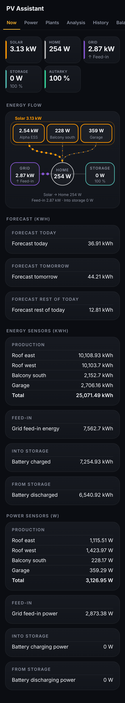</a>  <a href="https://raw.githubusercontent.com/weskona/pv-assistant/main/docs/screenshots/mobile/en/06-balance.png">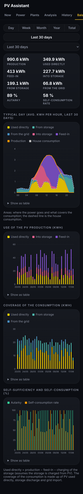</a>

### Now
<a href="https://raw.githubusercontent.com/weskona/pv-assistant/main/docs/screenshots/en/01-now.png">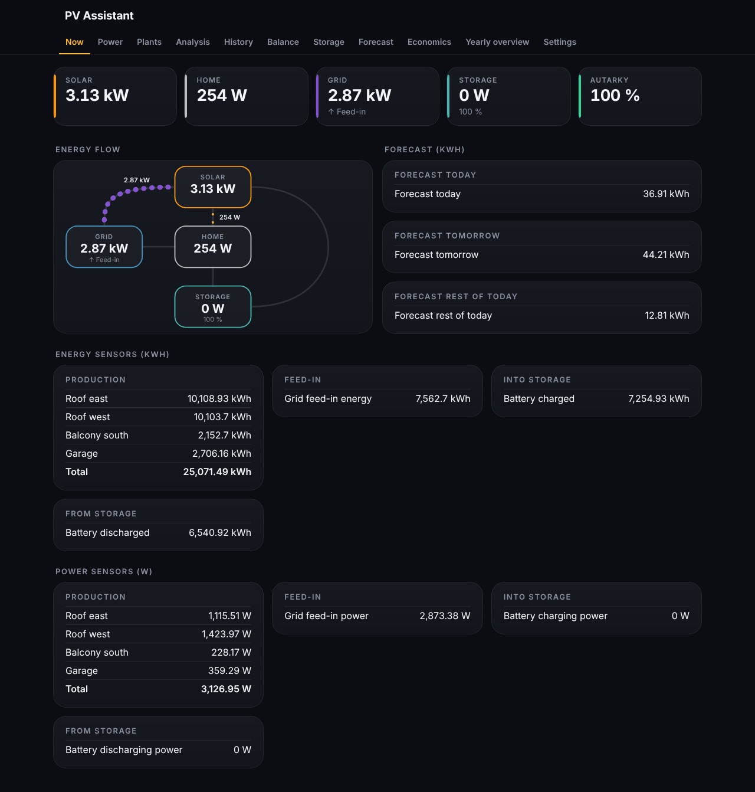</a>

An **energy flow** diagram on top shows the current power flows between solar, home, grid and storage as animated lines (direct use, feed-in, grid import, charging, discharging) with the current values and the battery level. It needs power sensors; grid and storage appear only if configured.

Below it cards for all configured sensors (energy and power) with current values and sums, plus the forecast sensors.

### Power
<a href="https://raw.githubusercontent.com/weskona/pv-assistant/main/docs/screenshots/en/02-power.png">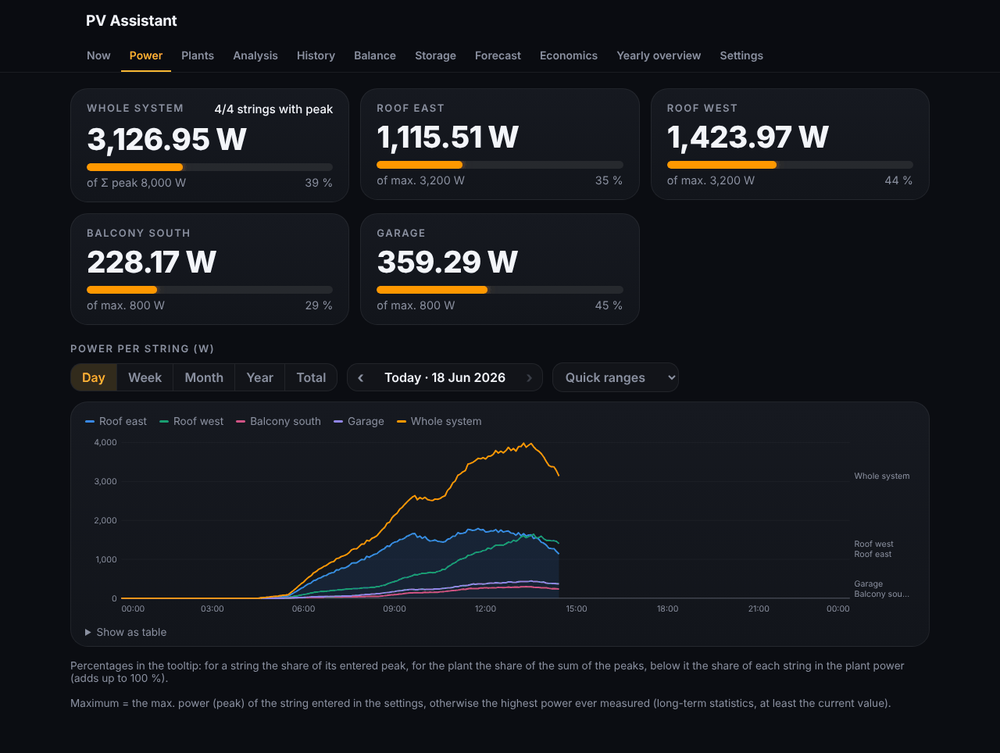</a>

Current power per string as a bar relative to the highest measured power (or the entered peak) and the effective power of the **whole plant** in percent. Below it a chart with the power curve per string and for the whole plant (today, yesterday, 7 days).

### Plants
<a href="https://raw.githubusercontent.com/weskona/pv-assistant/main/docs/screenshots/en/03-plants.png">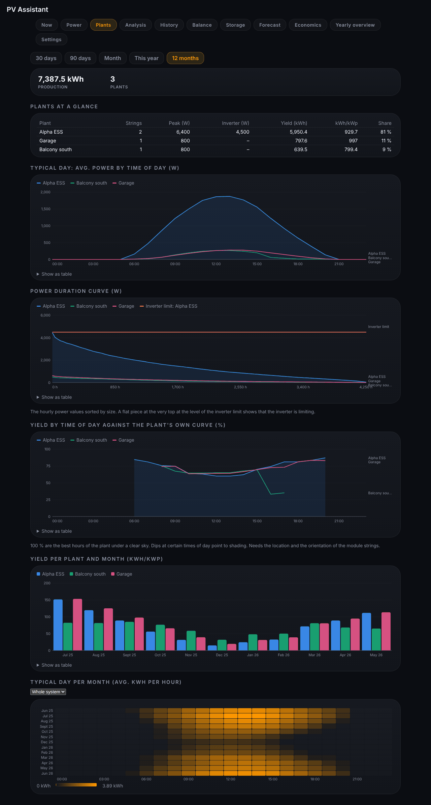</a>

A plant is an inverter with all its strings (see [[Settings]]).
- Table of all plants: strings, peak, inverter power, yield, kWh/kWp and share
- Typical day: average power of every plant by time of day
- Power duration curve: the hourly power values sorted by size, with the inverter limit as a line; a flat piece at the limit shows clipping
- Yield by time of day against the plant's own clear-sky curve in percent; dips at certain times of day point to shading (needs location and orientation)
- Yield per plant and month in kWh/kWp
- Heat map month × hour of the typical day, for the whole system or one plant

### Analysis
<a href="https://raw.githubusercontent.com/weskona/pv-assistant/main/docs/screenshots/en/04-analysis.png">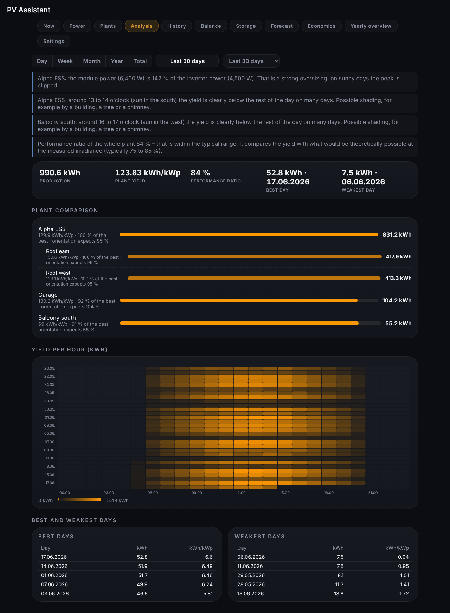</a>

- Plant comparison in kWh/kWp (sum per inverter), corrected for orientation and tilt, with a hint and a **suggestion** for weak plants; a plant with several sensors lists its strings indented below it, each with its yield and compared with the best string of the plant
- A hint if a plant is clearly below the others in some months (the monthly chart is on the Plants tab)
- **Sudden drop**: a hint when a plant has delivered clearly less than usual compared with the others over the last 3 days (snow, leaves, dirt, new shading, a failed string; needs peaks and at least 10 days) and the **orientation potential**: how much more a plant with a poor orientation would yield in the best case
- Estimated energy lost at the inverter limit (kWh and share, needs the plant location) and **possible shading**: hours of the day in which a plant stays clearly below its own clear-sky curve on many days, with the direction of the sun
- Heat map hour × day (weekly from 90 days on)
- Best and weakest days (with year; days below 0.1 kWh are ignored)
- Hint on power plateaus (inverter limiting, from 3 days)
- Performance ratio (with irradiance sensor)
- Production comes from the energy counters (like the Energy dashboard); a hint appears if it differs from the power sum by 3 % or more.

### History
<a href="https://raw.githubusercontent.com/weskona/pv-assistant/main/docs/screenshots/en/05-history.png">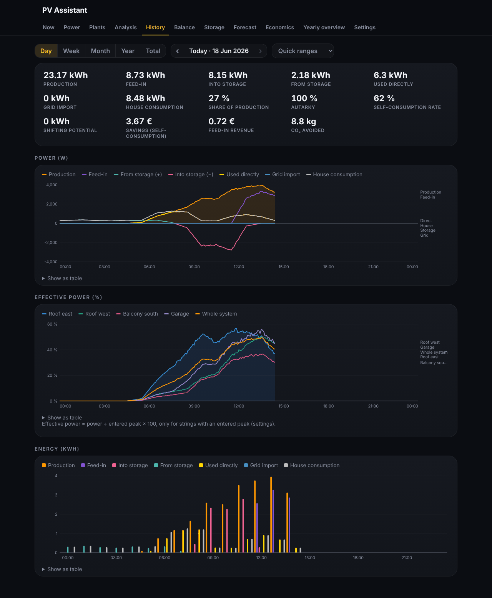</a>

In the year ranges the power charts show daily means and the energy chart shows monthly groups.
- Key figures: production, feed-in, storage, direct consumption, grid import, house consumption, autarky, self-consumption rate, shifting potential, savings, feed-in revenue, CO₂; with price sensors that have long-term statistics also the average import price and feed-in tariff weighted by the energy, compared with the plain average price
- Charts: power, effective power of the strings in %, energy
- Mouseover splits sources (for example the individual strings); every chart is also available as a table.

### Balance
<a href="https://raw.githubusercontent.com/weskona/pv-assistant/main/docs/screenshots/en/06-balance.png">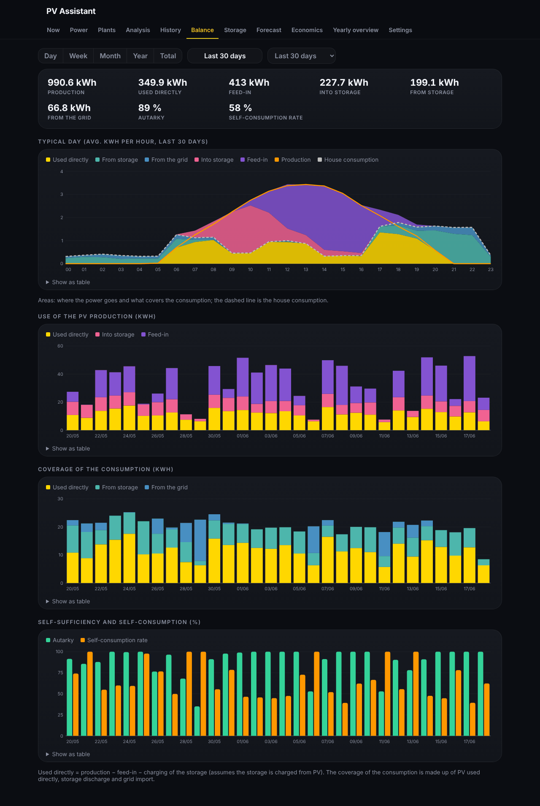</a>

Needs production energy sensors and at least one of feed-in, grid import or storage.
- Day profile as stacked areas per hour (kWh): used directly, from storage, from the grid, into the storage, fed in, with the production and the house consumption (dashed) as lines. For a single day it shows that day, for longer ranges the average day of the last 30 days of the range
- Use of the PV production as stacked bars: used directly, into the storage, fed in
- Coverage of the consumption as stacked bars: PV used directly, from the storage, from the grid
- Self-sufficiency and self-consumption rate per day or month
- Key figures of the range (production, direct use, feed-in, charging, discharging, grid import, rates); the direct use assumes that the storage is charged from PV

### Consumption
<a href="https://raw.githubusercontent.com/weskona/pv-assistant/main/docs/screenshots/en/07-consumption.png">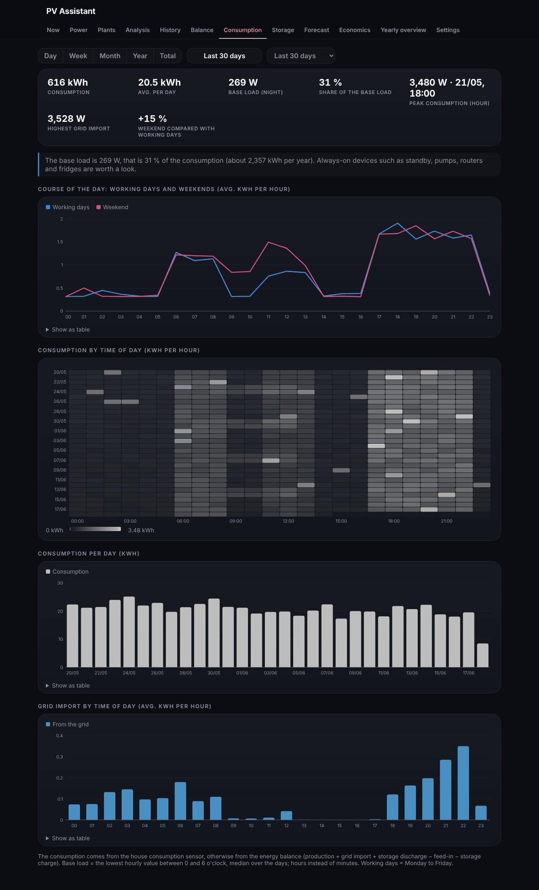</a>

Needs a house consumption sensor (energy or power), or production, feed-in and grid import as energy sensors (the consumption is then calculated from the energy balance).
- Key figures: consumption, average per day, **base load** (the lowest hourly value between 0 and 6 o'clock, median over the days) and its share of the consumption, peak consumption of an hour, **highest grid import**, weekend compared with working days
- A hint when the base load is more than a quarter of the consumption (standby, pumps, routers, fridges), with the energy per year
- Course of the day on working days and weekends (average kWh per hour)
- Heat map of the consumption by time of day (one row per day or month) and the consumption per day or month
- Grid import by time of day

### Storage
<a href="https://raw.githubusercontent.com/weskona/pv-assistant/main/docs/screenshots/en/08-storage.png">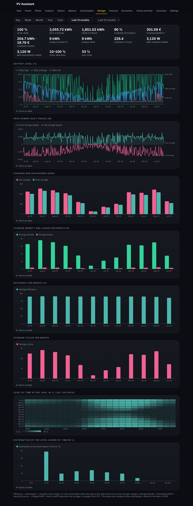</a>

Only visible with storage sensors or a battery level.
- Key figures: level now, charged, discharged, efficiency, **storage benefit** and **storage losses** in kWh and € (with prices), cycles (with storage capacity), maximum charge and discharge power, level min–max, average level; a hint appears if the efficiency fell clearly over the months
- Charts: level, storage power (from storage +, into storage −, per device), charged and discharged energy; in long ranges also benefit and losses per month in € and the efficiency per month; the distribution of the level (share of the time per 10 % band)
- Cycles per month (long ranges) and the **level by time of day** as a heat map (when is the storage empty in the evening; one row per day or month)
- **Scenario calculator** for the storage: enter the usable size, the maximum charge and discharge power, the efficiency and, for the payback, the price per kWh (the values are remembered in the browser). The panel shows self-sufficiency, self-consumption rate, grid import and feed-in per year, the benefit per year against no storage, the extra benefit of the last kWh, the investment and the payback, plus charts of self-sufficiency, benefit and the **extra benefit per further kWh** over the storage size (★ = your size, ◆ = the size in the calculator). It uses the hourly values of the last 30 days to 12 months scaled to a year and checks itself: with your current size it simulates the grid import and compares it with the measured one (a deviation over 15 % means rough guide values). Beyond the storage the calculator can also try **more production** (in percent, with the kWp it means and a price per kWp for the payback) and an **extra consumption** such as a wallbox or a heat pump (kWh per day over a time window of the day): it shows how much of it PV and storage cover and what it costs per kWh. A **matrix** shows self-sufficiency and benefit per year for storage size against more production, and up to 5 **scenarios can be saved** (in the browser) and compared side by side. Needs production and the house consumption (or grid import and feed-in) as energy sensors; a guide value, not an offer

### Forecast
<a href="https://raw.githubusercontent.com/weskona/pv-assistant/main/docs/screenshots/en/09-forecast.png">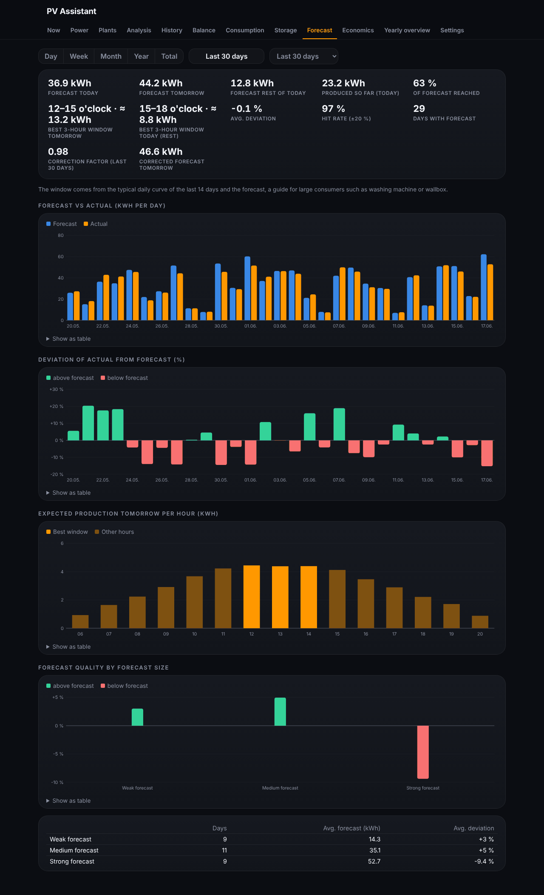</a>

Only visible with forecast sensors.
- Forecast today, tomorrow, rest of today, produced so far, share of forecast reached
- Forecast vs actual and deviation per day (per month from 90 days on), average deviation, hit rate (±20 %). The forecast of past days comes from three sources, the newest wins: the log of the integration (the last forecast of every day since the forecast sensors were set up, up to 800 days), the recorder history of the sensor (as far back as Home Assistant keeps states, see `purge_keep_days`) and the long-term statistics of the sensor (only if it has a state class; many forecast sensors have none). The tab says where the history starts when the chosen range asks for more.
- **Best 3-hour window** for tomorrow and for the rest of today (typical daily curve of the last 14 days combined with the forecast) as a guide for large consumers
- Forecast quality by forecast size: weak, medium and strong forecast days with their average deviation, as a chart and a table (from 9 days on)
- Chart of the expected production tomorrow per hour with the best window highlighted
- **Correction factor** of the last 30 days (produced energy per forecast kWh) and the **corrected forecast for tomorrow** (with the factor of the matching size group when there are enough days)

### Economics
<a href="https://raw.githubusercontent.com/weskona/pv-assistant/main/docs/screenshots/en/10-economics.png">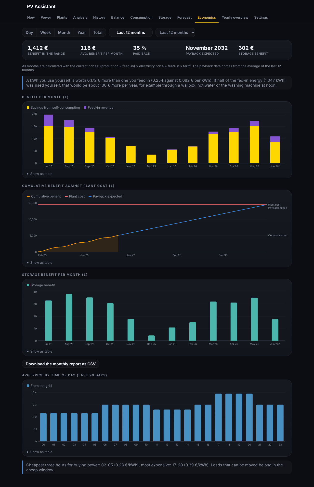</a>

Only visible with production and feed-in energy sensors and prices (settings or price sensors).
- Benefit per month as stacked bars: savings from self-consumption and feed-in revenue
- Cumulative benefit since the first recorded month against the plant cost, with the extrapolation to the payback date (average of the last 12 months, up to 40 years)
- Storage benefit per month with storage sensors
- Key figures: benefit in the range, average per month, share paid back, expected payback month, storage benefit
- All months are calculated with the current prices
- A hint whether self-consumption is worth more than feeding in (value per kWh, what half of the fed-in energy would bring per year), the **average price by time of day** of the last 90 days with the cheapest and the most expensive three hours (with price sensors that have statistics, for a dynamic tariff) and a button for the **monthly report as CSV** (all recorded months: production, feed-in, grid import, consumption, storage, direct use, rates, savings, revenue, benefit; `;` as separator, dot as decimal separator, opens in a spreadsheet)

### Yearly overview
<a href="https://raw.githubusercontent.com/weskona/pv-assistant/main/docs/screenshots/en/11-yearly.png">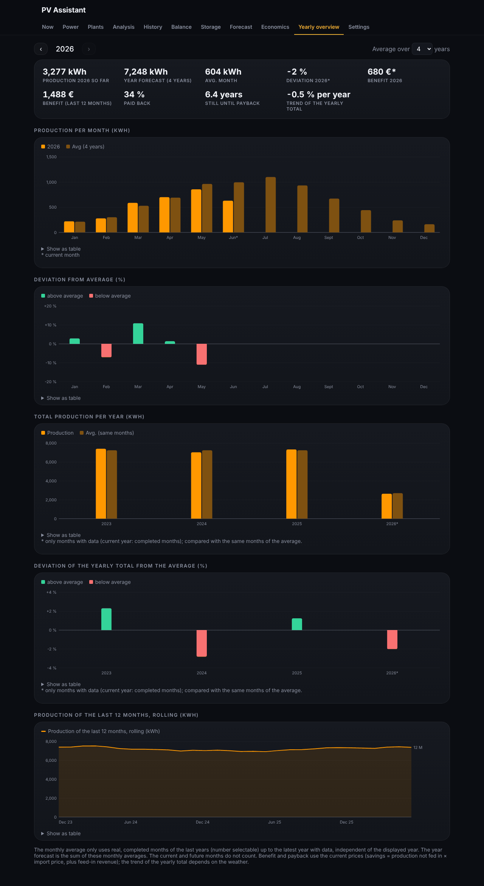</a>

Monthly production of the selected year next to the monthly average, deviation in percent, year forecast, comparison of all years, change against the previous year (same months), benefit, payback and trend of the yearly total; production of the last 12 months as a rolling sum; with a steady loss of more than 0.7 % per year a hint on possible degradation (not weather-corrected).

### Settings

See [[Settings]].

---

## Deutsch

Alle Kennzahlen eines Tabs stehen gemeinsam in einer Karte. Tabs ohne passende Sensoren werden ausgeblendet.

Die Kopfleiste mit den Tabs bleibt beim Scrollen sichtbar und ist einzeilig (auf schmalen Bildschirmen seitlich scrollbar). **Aktuell** beginnt mit einer Kennzahlen-Leiste: PV, Haus, Netz, Speicher und Autarkie.

**Zeitraum-Wähler:** Jeder Tab mit auswählbaren Daten (Leistung, Anlagen, Analyse, Verlauf, Energiebilanz, Speicher, Prognose, Wirtschaft) hat denselben kompakten Wähler: die Einheit **Tag · Woche · Monat · Jahr · Gesamt**, Pfeile zum Blättern durch die Zeiträume, in der Mitte das Datum (ein Klick darauf öffnet einen kleinen Kalender: Tage mit Kalenderwochen, Monate oder Jahre; der erste Monat mit Daten und heute begrenzen ihn) und eine **Schnellwahl** (Heute, Gestern, Letzte 7 / 30 / 90 Tage, Letzte 12 Monate). Ein Klick auf die aktive Einheit springt zum aktuellen Zeitraum. Gesamt umfasst alles Aufgezeichnete (beim ersten Mal werden einmalig die Langzeitstatistiken gelesen); die Tabs, die Stundenwerte laden (Anlagen, Analyse), laden bei Gesamt höchstens die letzten 5 Jahre und weisen darauf hin. In der Wirtschaft nutzen Tag, Woche, Monat und die letzten n Tage Tageswerte, Jahr, 12 Monate und Gesamt Monatswerte. Die Jahresübersicht hat ihre eigene Jahresauswahl.

**Handy:** Das Panel passt sich schmalen Bildschirmen an. Die Tab-Leiste scrollt seitlich, der Energiefluss wird in der verfügbaren Breite neu gezeichnet (die Anlagen laufen in mehrere Zeilen um), die Kennzahlen stehen in zwei Spalten, und breite Tabellen scrollen innerhalb ihrer Karte.

<a href="https://raw.githubusercontent.com/weskona/pv-assistant/main/docs/screenshots/mobile/de/01-now.png">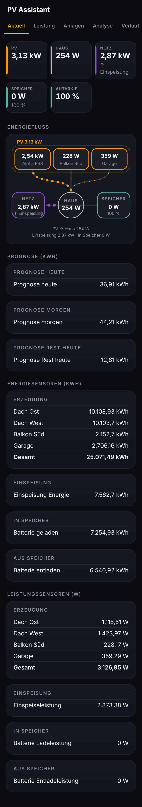</a> <a href="https://raw.githubusercontent.com/weskona/pv-assistant/main/docs/screenshots/mobile/de/03-plants.png">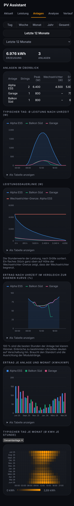</a> <a href="https://raw.githubusercontent.com/weskona/pv-assistant/main/docs/screenshots/mobile/de/06-balance.png">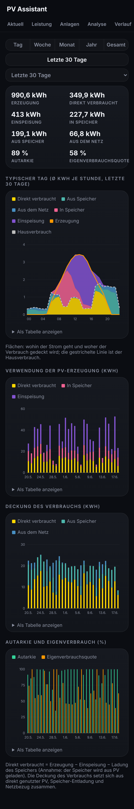</a>

### Aktuell
<a href="https://raw.githubusercontent.com/weskona/pv-assistant/main/docs/screenshots/de/01-now.png">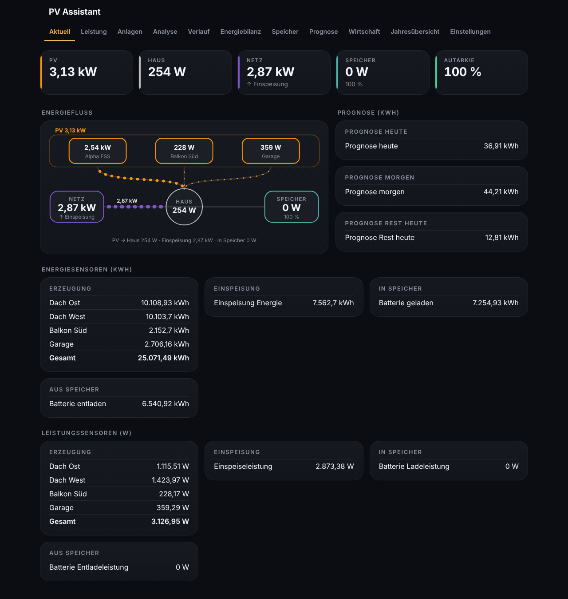</a>

Oben ein **Energiefluss**-Diagramm: die aktuellen Leistungsflüsse zwischen PV, Haus, Netz und Speicher als animierte Linien (Direktverbrauch, Einspeisung, Netzbezug, Laden, Entladen) mit den aktuellen Werten und dem Ladestand. Es braucht Leistungssensoren; Netz und Speicher erscheinen nur, wenn sie konfiguriert sind.

Darunter Karten für alle konfigurierten Sensoren (Energie und Leistung) mit aktuellen Werten und Summen, dazu die Prognose-Sensoren.

### Leistung
<a href="https://raw.githubusercontent.com/weskona/pv-assistant/main/docs/screenshots/de/02-power.png">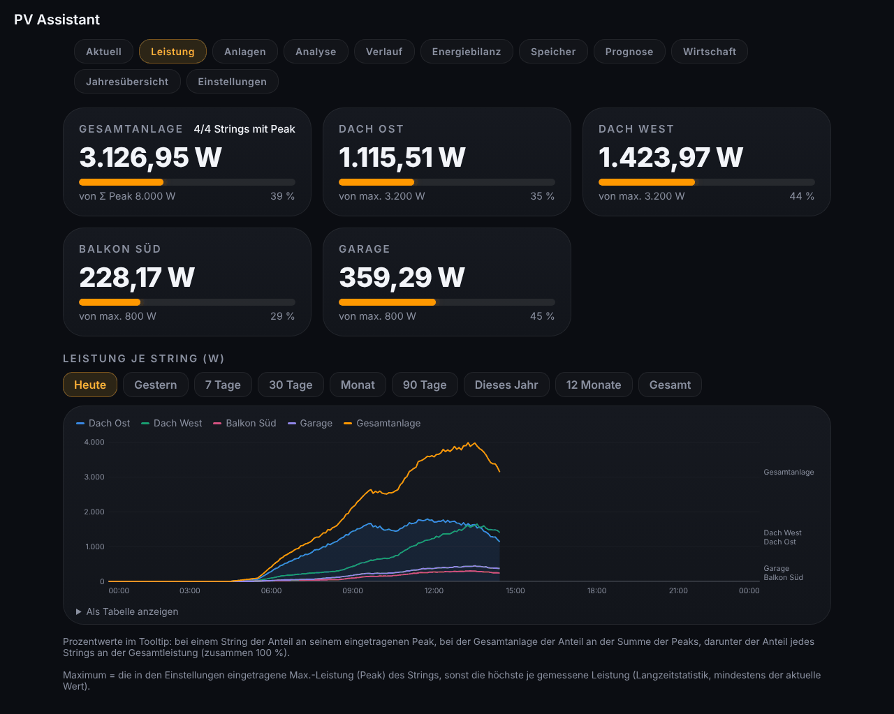</a>

Aktuelle Leistung je String als Balken im Verhältnis zur höchsten gemessenen Leistung (oder dem eingetragenen Peak) und die effektive Leistung der **Gesamtanlage** in Prozent. Darunter ein Diagramm mit dem Leistungsverlauf je String und der Gesamtanlage (Heute, Gestern, 7 Tage).

### Anlagen
<a href="https://raw.githubusercontent.com/weskona/pv-assistant/main/docs/screenshots/de/03-plants.png">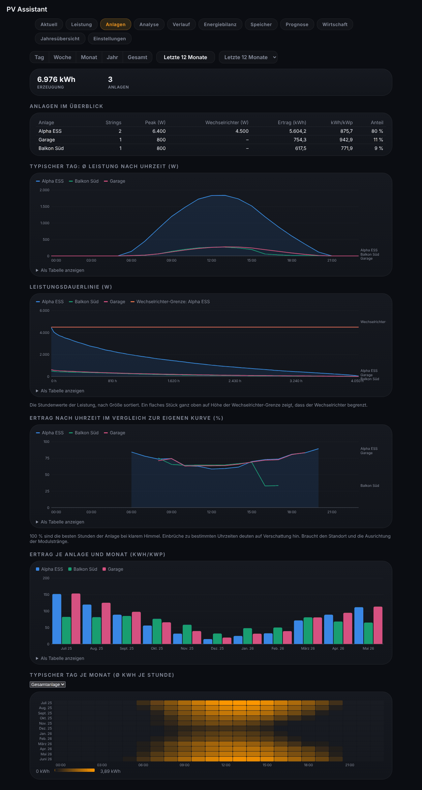</a>

Eine Anlage ist ein Wechselrichter mit allen seinen Strings (siehe [[Einstellungen|Settings]]).
- Tabelle aller Anlagen: Strings, Peak, Wechselrichter-Leistung, Ertrag, kWh/kWp und Anteil
- Typischer Tag: durchschnittliche Leistung jeder Anlage nach Uhrzeit
- Leistungsdauerlinie: die Stundenwerte der Leistung nach Größe sortiert, mit der Wechselrichter-Grenze als Linie; ein flaches Stück an der Grenze zeigt Begrenzung
- Ertrag nach Uhrzeit im Vergleich zur eigenen Kurve bei klarem Himmel in Prozent; Einbrüche zu bestimmten Uhrzeiten deuten auf Verschattung hin (braucht Standort und Ausrichtung)
- Ertrag je Anlage und Monat in kWh/kWp
- Heatmap Monat × Stunde des typischen Tages, für die Gesamtanlage oder eine Anlage

### Analyse
<a href="https://raw.githubusercontent.com/weskona/pv-assistant/main/docs/screenshots/de/04-analysis.png">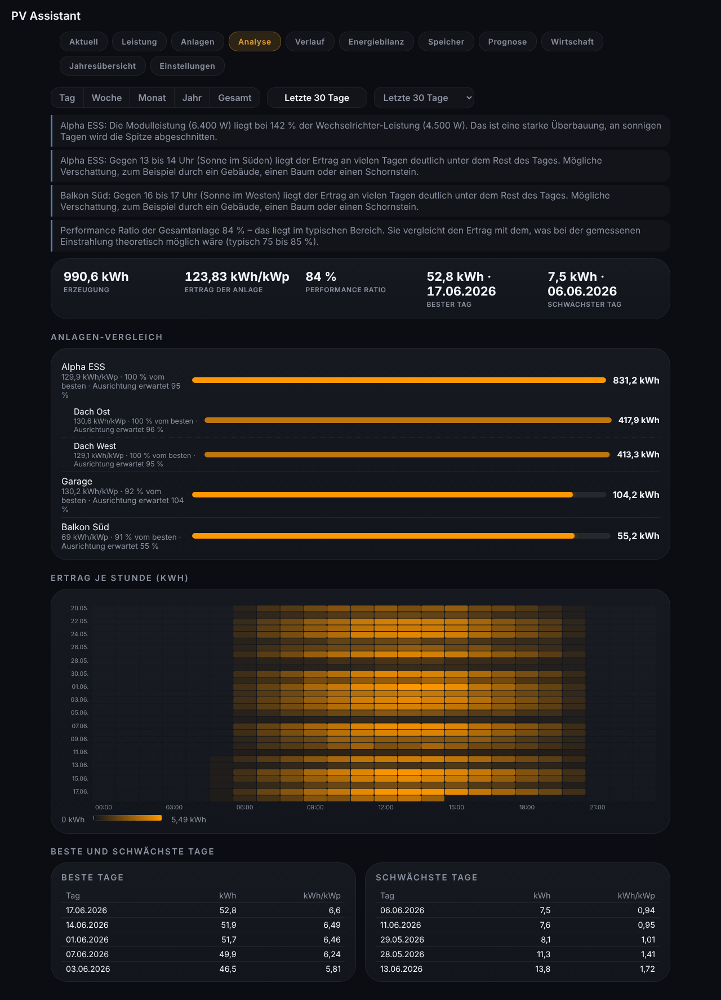</a>

- Anlagen-Vergleich in kWh/kWp (Summe je Wechselrichter), bereinigt um Ausrichtung und Neigung, mit Hinweis und **Vorschlag** bei schwachen Anlagen; eine Anlage mit mehreren Sensoren zeigt ihre Strings eingerückt darunter, je mit Ertrag und im Vergleich zum besten String der Anlage
- Hinweis, wenn eine Anlage in einzelnen Monaten deutlich unter den anderen liegt (das Monatsdiagramm steht im Tab „Anlagen“)
- **Plötzlicher Einbruch**: ein Hinweis, wenn eine Anlage in den letzten 3 Tagen deutlich weniger geliefert hat als sonst im Vergleich zu den anderen (Schnee, Laub, Schmutz, neue Verschattung, ausgefallener String; braucht Peaks und mindestens 10 Tage) und das **Ausrichtungs-Potenzial**: wie viel mehr eine Anlage mit schlechter Ausrichtung im besten Fall bringen würde
- Geschätzte Energie, die an der Wechselrichter-Grenze verloren ging (kWh und Anteil, braucht den Anlagenstandort) und **mögliche Verschattung**: Tagesstunden, in denen eine Anlage an vielen Tagen deutlich unter ihrer eigenen Kurve bei klarem Himmel bleibt, mit der Richtung der Sonne
- Heatmap Stunde × Tag (ab 90 Tagen wochenweise)
- Beste und schwächste Tage (mit Jahr; Tage unter 0,1 kWh zählen nicht)
- Hinweis auf Leistungs-Plateaus (Wechselrichter-Begrenzung, ab 3 Tagen)
- Performance Ratio (mit Einstrahlungssensor)
- Die Erzeugung stammt aus den Energiezählern (wie im Energy-Dashboard); ab 3 % Abweichung zur Leistungssumme erscheint ein Hinweis.

### Verlauf
<a href="https://raw.githubusercontent.com/weskona/pv-assistant/main/docs/screenshots/de/05-history.png">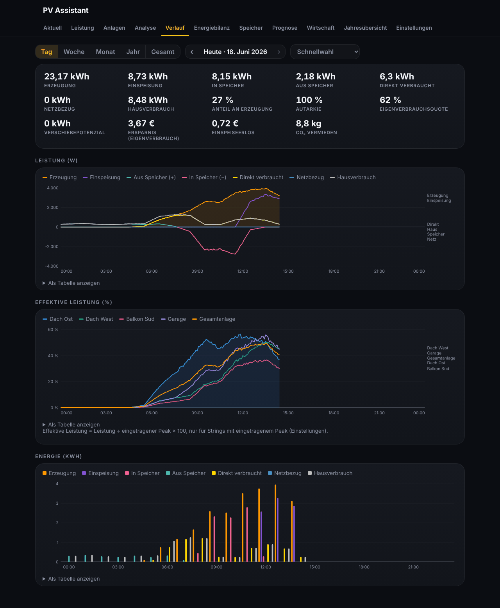</a>

Bei den Jahreszeiträumen zeigen Leistungsdiagramme Tagesmittel und das Energiediagramm Monatsgruppen.
- Kennzahlen: Erzeugung, Einspeisung, Speicher, Direktverbrauch, Netzbezug, Hausverbrauch, Autarkie, Eigenverbrauchsquote, Verschiebepotenzial, Ersparnis, Einspeiseerlös, CO₂; mit Preis-Sensoren, die Langzeitstatistiken haben, außerdem der mit der Energie gewichtete Ø Bezugspreis und die gewichtete Einspeisevergütung im Vergleich zum einfachen Durchschnittspreis
- Diagramme: Leistung, effektive Leistung der Strings in %, Energie
- Mouseover teilt Quellen auf (z. B. die einzelnen Strings); jedes Diagramm gibt es auch als Tabelle.

### Energiebilanz
<a href="https://raw.githubusercontent.com/weskona/pv-assistant/main/docs/screenshots/de/06-balance.png">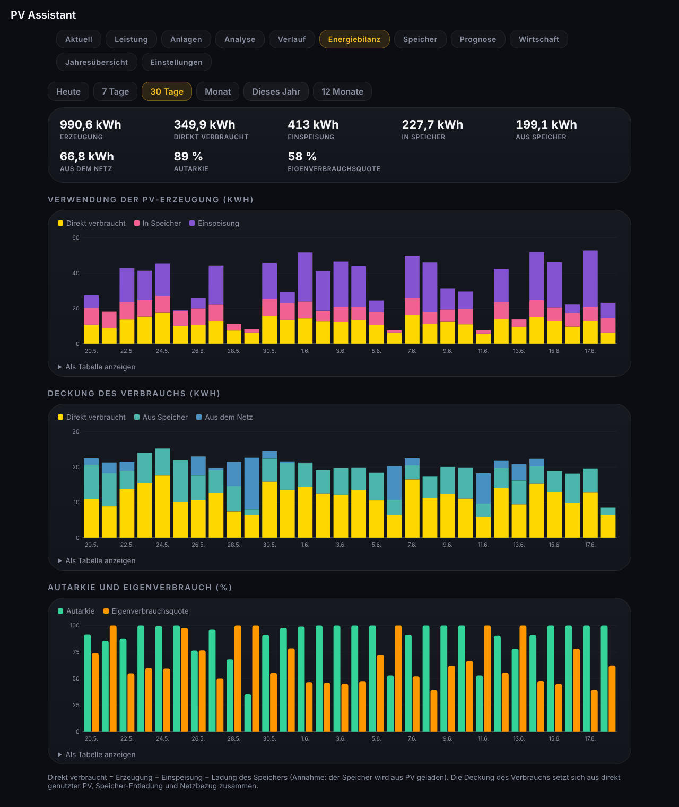</a>

Braucht Erzeugungs-Energiesensoren und mindestens einen von Einspeisung, Netzbezug oder Speicher.
- Tagesprofil als gestapelte Flächen je Stunde (kWh): direkt verbraucht, aus Speicher, aus dem Netz, in den Speicher, eingespeist, dazu Erzeugung und Hausverbrauch (gestrichelt) als Linien. Für einen Tag wird dieser Tag gezeigt, für längere Zeiträume der Durchschnittstag der letzten 30 Tage des Zeitraums
- Verwendung der PV-Erzeugung als gestapelte Balken: direkt verbraucht, in den Speicher, eingespeist
- Deckung des Verbrauchs als gestapelte Balken: direkt genutzte PV, aus dem Speicher, aus dem Netz
- Autarkie und Eigenverbrauchsquote je Tag oder Monat
- Kennzahlen des Zeitraums (Erzeugung, Direktverbrauch, Einspeisung, Laden, Entladen, Netzbezug, Quoten); der Direktverbrauch nimmt an, dass der Speicher aus PV geladen wird

### Verbrauch

Braucht einen Hausverbrauchssensor (Energie oder Leistung) oder Erzeugung, Einspeisung und Netzbezug als Energiesensoren (der Verbrauch wird dann aus der Energiebilanz berechnet).
- Kennzahlen: Verbrauch, Durchschnitt je Tag, **Grundlast** (der niedrigste Stundenwert zwischen 0 und 6 Uhr, Median über die Tage) und ihr Anteil am Verbrauch, Spitzenverbrauch einer Stunde, **höchster Netzbezug**, Wochenende gegenüber Werktagen
- Ein Hinweis, wenn die Grundlast mehr als ein Viertel des Verbrauchs ausmacht (Standby, Pumpen, Router, Kühlgeräte), mit der Energie pro Jahr
- Tagesverlauf an Werktagen und am Wochenende (Ø kWh je Stunde)
- Heatmap des Verbrauchs nach Uhrzeit (eine Zeile je Tag oder Monat) und der Verbrauch je Tag oder Monat
- Netzbezug nach Uhrzeit

### Speicher
<a href="https://raw.githubusercontent.com/weskona/pv-assistant/main/docs/screenshots/de/08-storage.png">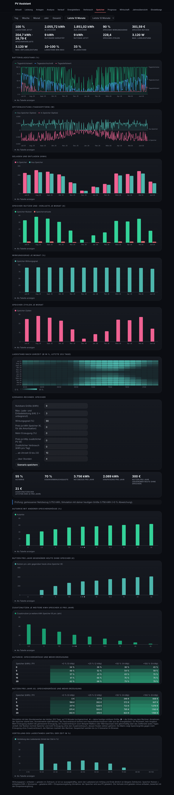</a>

Nur sichtbar mit Speichersensoren oder Ladestand.
- Kennzahlen: Ladestand jetzt, geladen, entladen, Wirkungsgrad, **Speicher-Nutzen** und **Speicherverluste** in kWh und € (mit Preisen), Zyklen (mit Speicherkapazität), maximale Lade- und Entladeleistung, Ladestand min–max, Ø Ladestand; ein Hinweis erscheint, wenn der Wirkungsgrad über die Monate deutlich gesunken ist
- Diagramme: Ladestand, Speicherleistung (aus Speicher +, in Speicher −, je Gerät), geladene und entladene Energie; in langen Zeiträumen außerdem Nutzen und Verluste je Monat in € und der Wirkungsgrad je Monat; die Verteilung des Ladestands (Anteil der Zeit je 10-%-Stufe)
- Zyklen je Monat (lange Zeiträume) und der **Ladestand nach Uhrzeit** als Heatmap (wann ist der Speicher abends leer; eine Zeile je Tag oder Monat)
- **Szenario-Rechner** für den Speicher: nutzbare Größe, maximale Lade- und Entladeleistung, Wirkungsgrad und, für die Amortisation, der Preis je kWh eingeben (die Werte merkt sich der Browser). Das Panel zeigt Autarkie, Eigenverbrauchsquote, Netzbezug und Einspeisung pro Jahr, den Nutzen pro Jahr gegenüber ohne Speicher, den Zusatznutzen der letzten kWh, die Investition und die Amortisation, dazu Diagramme von Autarkie, Nutzen und dem **Zusatznutzen je weitere kWh** über der Speichergröße (★ = deine Größe, ◆ = die Größe im Rechner). Gerechnet wird mit den Stundenwerten der letzten 30 Tage bis 12 Monate, auf ein Jahr hochgerechnet, mit eingebauter Prüfung: Mit deiner heutigen Größe wird der Netzbezug simuliert und mit dem gemessenen verglichen (über 15 % Abweichung bedeuten grobe Richtwerte). Neben dem Speicher kann der Rechner auch **mehr Erzeugung** (in Prozent, mit den kWp, die das bedeutet, und einem Preis je kWp für die Amortisation) und einen **Zusatzverbrauch** wie Wallbox oder Wärmepumpe (kWh pro Tag über ein Zeitfenster des Tages) durchspielen: Er zeigt, wie viel davon PV und Speicher decken und was es je kWh kostet. Eine **Matrix** zeigt Autarkie und Nutzen pro Jahr für Speichergröße gegen mehr Erzeugung, und bis zu 5 **Szenarien lassen sich speichern** (im Browser) und nebeneinander vergleichen. Braucht Erzeugung und Hausverbrauch (oder Netzbezug und Einspeisung) als Energiesensoren; ein Richtwert, kein Angebot

### Prognose

Nur sichtbar mit Prognose-Sensoren.
- Prognose heute, morgen, Rest heute, bisher erzeugt, von Prognose erreicht
- Prognose gegen Ist und Abweichung je Tag (ab 90 Tagen je Monat), Ø Abweichung, Trefferquote (±20 %). Die Prognose vergangener Tage kommt aus drei Quellen, die neueste gewinnt: dem Protokoll der Integration (die letzte Prognose jedes Tages, seit die Prognose-Sensoren eingerichtet sind, bis zu 800 Tage), dem Recorder-Verlauf des Sensors (so weit zurück, wie Home Assistant Zustände behält, siehe `purge_keep_days`) und den Langzeitstatistiken des Sensors (nur mit State Class; viele Prognose-Sensoren haben keine). Der Tab nennt den Beginn des Verlaufs, wenn der gewählte Zeitraum mehr verlangt.
- **Bestes 3-Stunden-Fenster** für morgen und für den Rest von heute (typischer Tagesverlauf der letzten 14 Tage zusammen mit der Prognose) als Richtwert für Großverbraucher
- Prognose-Güte nach Größe der Prognose: schwache, mittlere und starke Prognosetage mit ihrer durchschnittlichen Abweichung, als Diagramm und Tabelle (ab 9 Tagen)
- Diagramm der erwarteten Erzeugung morgen je Stunde, das beste Fenster hervorgehoben
- **Korrekturfaktor** der letzten 30 Tage (erzeugte Energie je Prognose-kWh) und die **korrigierte Prognose für morgen** (mit dem Faktor der passenden Größengruppe, wenn genug Tage da sind)

### Wirtschaft
<a href="https://raw.githubusercontent.com/weskona/pv-assistant/main/docs/screenshots/de/10-economics.png">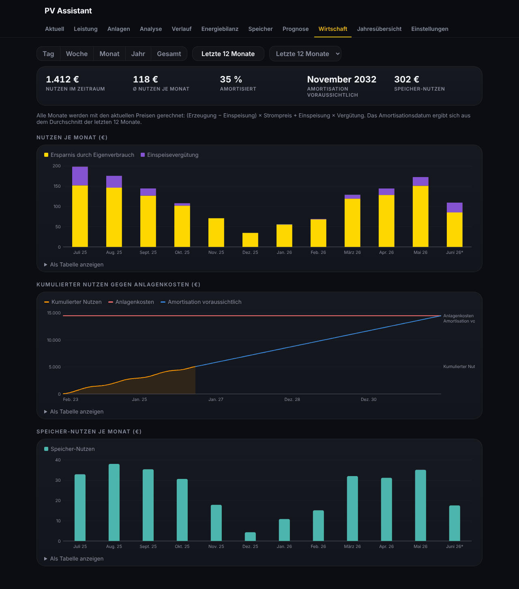</a>

Nur sichtbar mit Erzeugungs- und Einspeise-Energiesensoren und Preisen (Einstellungen oder Preis-Sensoren).
- Nutzen je Monat als gestapelte Balken: Ersparnis durch Eigenverbrauch und Einspeisevergütung
- Kumulierter Nutzen seit dem ersten aufgezeichneten Monat gegen die Anlagenkosten, mit der Fortschreibung bis zur Amortisation (Durchschnitt der letzten 12 Monate, bis 40 Jahre)
- Speicher-Nutzen je Monat mit Speichersensoren
- Kennzahlen: Nutzen im Zeitraum, Durchschnitt je Monat, amortisierter Anteil, voraussichtlicher Amortisationsmonat, Speicher-Nutzen
- Alle Monate werden mit den aktuellen Preisen gerechnet
- Ein Hinweis, ob Eigenverbrauch mehr wert ist als Einspeisen (Wert je kWh, was die Hälfte der eingespeisten Energie pro Jahr brächte), der **Ø Preis nach Uhrzeit** der letzten 90 Tage mit den günstigsten und teuersten drei Stunden (mit Preis-Sensoren, die Statistiken haben, für einen dynamischen Tarif) und ein Knopf für den **Monatsbericht als CSV** (alle aufgezeichneten Monate: Erzeugung, Einspeisung, Netzbezug, Verbrauch, Speicher, direkter Verbrauch, Quoten, Ersparnis, Erlös, Nutzen; `;` als Trennzeichen, Punkt als Dezimaltrennzeichen, öffnet sich in einer Tabellenkalkulation)

### Jahresübersicht

Monatserzeugung des gewählten Jahres neben dem Monatsschnitt, Abweichung in Prozent, Jahresprognose, Jahresvergleich über alle Jahre, Veränderung gegenüber dem Vorjahr (gleiche Monate), Nutzen, Amortisation und Trend der Jahressumme; Erzeugung der letzten 12 Monate als gleitende Summe; bei einem stetigen Verlust von mehr als 0,7 % pro Jahr ein Hinweis auf mögliche Degradation (nicht wetterbereinigt).

### Einstellungen
<a href="https://raw.githubusercontent.com/weskona/pv-assistant/main/docs/screenshots/de/12-settings.png">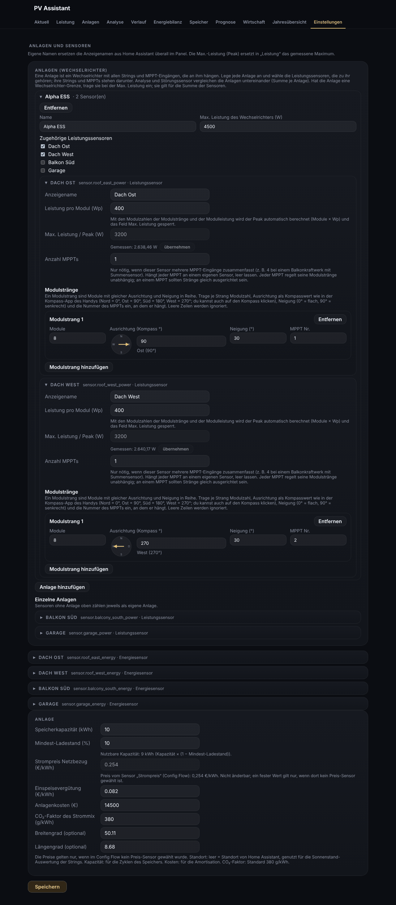</a>

Siehe [[Einstellungen|Settings]].
