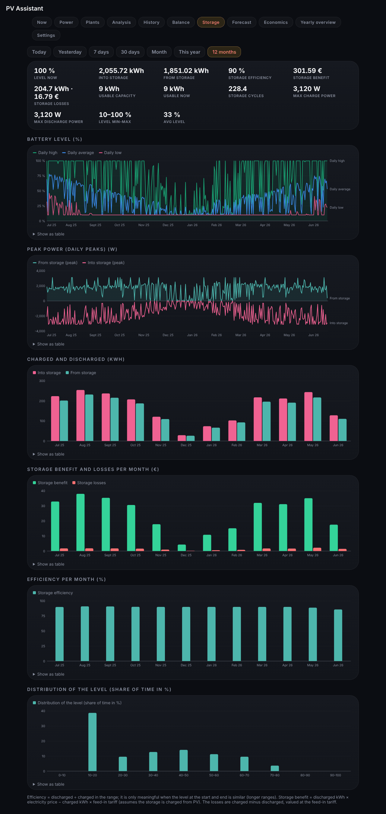
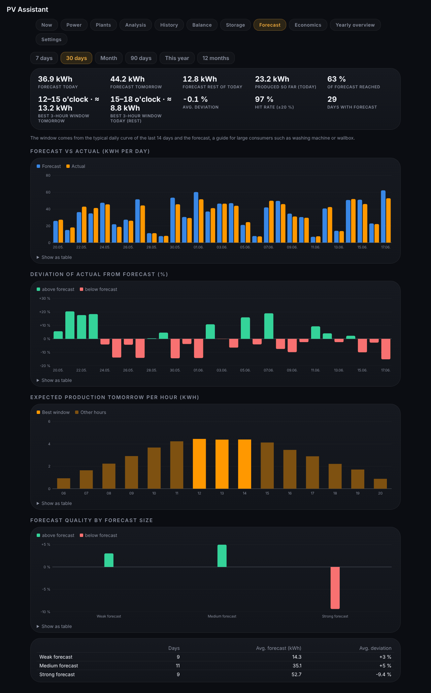
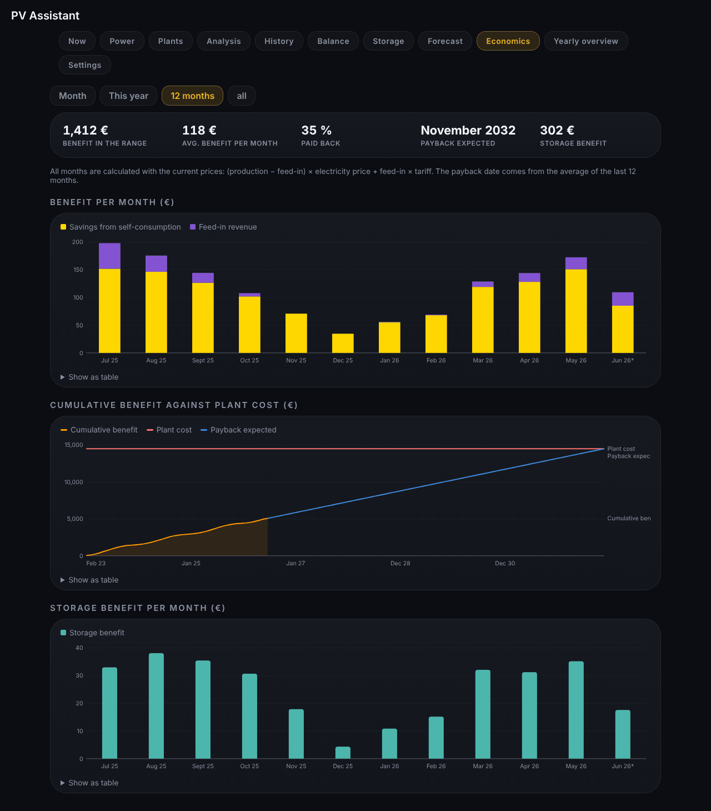
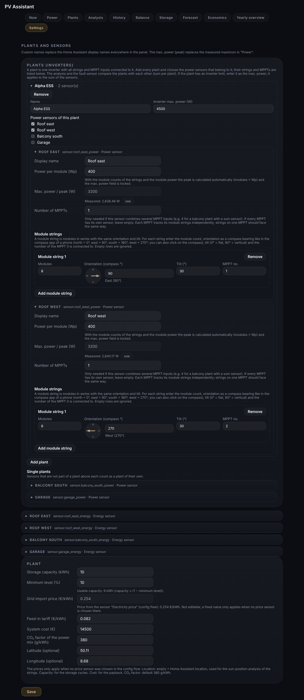
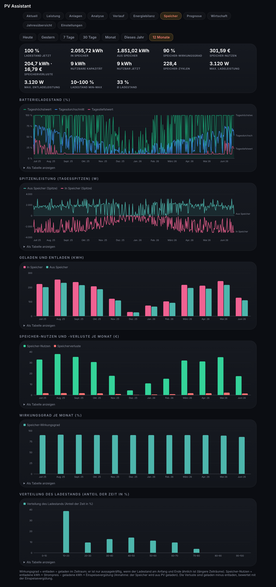
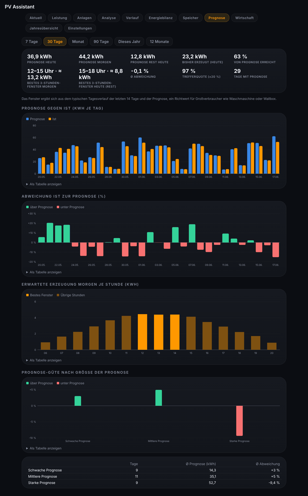
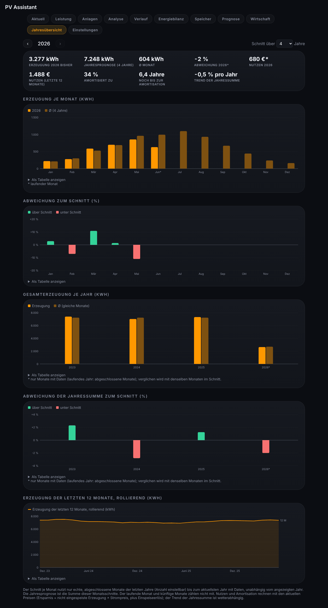

[English](#english) · [Deutsch](#deutsch)

## English

All key figures of a tab are shown together in one card. Tabs without matching sensors are hidden.

### Now

An **energy flow** diagram on top shows the current power flows between solar, home, grid and storage as animated lines (direct use, feed-in, grid import, charging, discharging) with the current values and the battery level. It needs power sensors; grid and storage appear only if configured.

Below it cards for all configured sensors (energy and power) with current values and sums, plus the forecast sensors.

### Power

Current power per string as a bar relative to the highest measured power (or the entered peak) and the effective power of the **whole plant** in percent. Below it a chart with the power curve per string and for the whole plant (today, yesterday, 7 days).

### Plants

Ranges 30, 90 days, **Month** (arrows), This year, 12 months. A plant is an inverter with all its strings (see [[Settings]]).
- Table of all plants: strings, peak, inverter power, yield, kWh/kWp and share
- Typical day: average power of every plant by time of day
- Power duration curve: the hourly power values sorted by size, with the inverter limit as a line; a flat piece at the limit shows clipping
- Yield by time of day against the plant's own clear-sky curve in percent; dips at certain times of day point to shading (needs location and orientation)
- Yield per plant and month in kWh/kWp
- Heat map month × hour of the typical day, for the whole system or one plant

### Analysis

Ranges 7, 30 days, **Month** (arrows), 90 days, **This year** or **12 months**.
- Plant comparison in kWh/kWp (sum per inverter), corrected for orientation and tilt, with a hint and a **suggestion** for weak plants; a plant with several sensors lists its strings indented below it, each with its yield and compared with the best string of the plant
- A hint if a plant is clearly below the others in some months (the monthly chart is on the Plants tab)
- Estimated energy lost at the inverter limit (kWh and share, needs the plant location) and **possible shading**: hours of the day in which a plant stays clearly below its own clear-sky curve on many days, with the direction of the sun
- Heat map hour × day (weekly from 90 days on)
- Best and weakest days (with year; days below 0.1 kWh are ignored)
- Hint on power plateaus (inverter limiting, from 3 days)
- Performance ratio (with irradiance sensor)
- Production comes from the energy counters (like the Energy dashboard); a hint appears if it differs from the power sum by 3 % or more.

### History

Ranges Today, Yesterday, 7 days, 30 days, **Month** (with arrows to page through the months), **This year**, **12 months**. In the year ranges the power charts show daily means and the energy chart shows monthly groups.
- Key figures: production, feed-in, storage, direct consumption, grid import, house consumption, autarky, self-consumption rate, shifting potential, savings, feed-in revenue, CO₂; with price sensors that have long-term statistics also the average import price and feed-in tariff weighted by the energy, compared with the plain average price
- Charts: power, effective power of the strings in %, energy
- Mouseover splits sources (for example the individual strings); every chart is also available as a table.

### Balance

Ranges Today, 7 days, 30 days, **Month** (arrows), This year, 12 months. Needs production energy sensors and at least one of feed-in, grid import or storage.
- Use of the PV production as stacked bars: used directly, into the storage, fed in
- Coverage of the consumption as stacked bars: PV used directly, from the storage, from the grid
- Self-sufficiency and self-consumption rate per day or month
- Key figures of the range (production, direct use, feed-in, charging, discharging, grid import, rates); the direct use assumes that the storage is charged from PV

### Storage

Only visible with storage sensors or a battery level. Same ranges as History.
- Key figures: level now, charged, discharged, efficiency, **storage benefit** and **storage losses** in kWh and € (with prices), cycles (with storage capacity), maximum charge and discharge power, level min–max, average level; a hint appears if the efficiency fell clearly over the months
- Charts: level, storage power (from storage +, into storage −, per device), charged and discharged energy; in long ranges also benefit and losses per month in € and the efficiency per month; the distribution of the level (share of the time per 10 % band)

### Forecast

Only visible with forecast sensors. Ranges 7, 30 days, **Month** (arrows), 90 days, This year, 12 months.
- Forecast today, tomorrow, rest of today, produced so far, share of forecast reached
- Forecast vs actual and deviation per day (per month from 90 days on), average deviation, hit rate (±20 %)
- **Best 3-hour window** for tomorrow and for the rest of today (typical daily curve of the last 14 days combined with the forecast) as a guide for large consumers
- Forecast quality by forecast size: weak, medium and strong forecast days with their average deviation, as a chart and a table (from 9 days on)
- Chart of the expected production tomorrow per hour with the best window highlighted

### Economics

Only visible with production and feed-in energy sensors and prices (settings or price sensors). Ranges **Month** (arrows), This year, 12 months, All.
- Benefit per month as stacked bars: savings from self-consumption and feed-in revenue
- Cumulative benefit since the first recorded month against the plant cost, with the extrapolation to the payback date (average of the last 12 months, up to 40 years)
- Storage benefit per month with storage sensors
- Key figures: benefit in the range, average per month, share paid back, expected payback month, storage benefit
- All months are calculated with the current prices

### Yearly overview

Monthly production of the selected year next to the monthly average, deviation in percent, year forecast, comparison of all years, change against the previous year (same months), benefit, payback and trend of the yearly total; production of the last 12 months as a rolling sum; with a steady loss of more than 0.7 % per year a hint on possible degradation (not weather-corrected).

### Settings

See [[Settings]].

---

## Deutsch

Alle Kennzahlen eines Tabs stehen gemeinsam in einer Karte. Tabs ohne passende Sensoren werden ausgeblendet.

### Aktuell

Oben ein **Energiefluss**-Diagramm: die aktuellen Leistungsflüsse zwischen PV, Haus, Netz und Speicher als animierte Linien (Direktverbrauch, Einspeisung, Netzbezug, Laden, Entladen) mit den aktuellen Werten und dem Ladestand. Es braucht Leistungssensoren; Netz und Speicher erscheinen nur, wenn sie konfiguriert sind.

Darunter Karten für alle konfigurierten Sensoren (Energie und Leistung) mit aktuellen Werten und Summen, dazu die Prognose-Sensoren.

### Leistung

Aktuelle Leistung je String als Balken im Verhältnis zur höchsten gemessenen Leistung (oder dem eingetragenen Peak) und die effektive Leistung der **Gesamtanlage** in Prozent. Darunter ein Diagramm mit dem Leistungsverlauf je String und der Gesamtanlage (Heute, Gestern, 7 Tage).

### Anlagen

Zeiträume 30, 90 Tage, **Monat** (Pfeile), Dieses Jahr, 12 Monate. Eine Anlage ist ein Wechselrichter mit allen seinen Strings (siehe [[Einstellungen|Settings]]).
- Tabelle aller Anlagen: Strings, Peak, Wechselrichter-Leistung, Ertrag, kWh/kWp und Anteil
- Typischer Tag: durchschnittliche Leistung jeder Anlage nach Uhrzeit
- Leistungsdauerlinie: die Stundenwerte der Leistung nach Größe sortiert, mit der Wechselrichter-Grenze als Linie; ein flaches Stück an der Grenze zeigt Begrenzung
- Ertrag nach Uhrzeit im Vergleich zur eigenen Kurve bei klarem Himmel in Prozent; Einbrüche zu bestimmten Uhrzeiten deuten auf Verschattung hin (braucht Standort und Ausrichtung)
- Ertrag je Anlage und Monat in kWh/kWp
- Heatmap Monat × Stunde des typischen Tages, für die Gesamtanlage oder eine Anlage

### Analyse

Zeiträume 7, 30 Tage, **Monat** (Pfeile), 90 Tage, **Dieses Jahr** oder **12 Monate**.
- Anlagen-Vergleich in kWh/kWp (Summe je Wechselrichter), bereinigt um Ausrichtung und Neigung, mit Hinweis und **Vorschlag** bei schwachen Anlagen; eine Anlage mit mehreren Sensoren zeigt ihre Strings eingerückt darunter, je mit Ertrag und im Vergleich zum besten String der Anlage
- Hinweis, wenn eine Anlage in einzelnen Monaten deutlich unter den anderen liegt (das Monatsdiagramm steht im Tab „Anlagen“)
- Geschätzte Energie, die an der Wechselrichter-Grenze verloren ging (kWh und Anteil, braucht den Anlagenstandort) und **mögliche Verschattung**: Tagesstunden, in denen eine Anlage an vielen Tagen deutlich unter ihrer eigenen Kurve bei klarem Himmel bleibt, mit der Richtung der Sonne
- Heatmap Stunde × Tag (ab 90 Tagen wochenweise)
- Beste und schwächste Tage (mit Jahr; Tage unter 0,1 kWh zählen nicht)
- Hinweis auf Leistungs-Plateaus (Wechselrichter-Begrenzung, ab 3 Tagen)
- Performance Ratio (mit Einstrahlungssensor)
- Die Erzeugung stammt aus den Energiezählern (wie im Energy-Dashboard); ab 3 % Abweichung zur Leistungssumme erscheint ein Hinweis.

### Verlauf

Zeiträume Heute, Gestern, 7 Tage, 30 Tage, **Monat** (mit Pfeilen zum Blättern durch die Monate), **Dieses Jahr**, **12 Monate**. Bei den Jahreszeiträumen zeigen Leistungsdiagramme Tagesmittel und das Energiediagramm Monatsgruppen.
- Kennzahlen: Erzeugung, Einspeisung, Speicher, Direktverbrauch, Netzbezug, Hausverbrauch, Autarkie, Eigenverbrauchsquote, Verschiebepotenzial, Ersparnis, Einspeiseerlös, CO₂; mit Preis-Sensoren, die Langzeitstatistiken haben, außerdem der mit der Energie gewichtete Ø Bezugspreis und die gewichtete Einspeisevergütung im Vergleich zum einfachen Durchschnittspreis
- Diagramme: Leistung, effektive Leistung der Strings in %, Energie
- Mouseover teilt Quellen auf (z. B. die einzelnen Strings); jedes Diagramm gibt es auch als Tabelle.

### Energiebilanz

Zeiträume Heute, 7 Tage, 30 Tage, **Monat** (Pfeile), Dieses Jahr, 12 Monate. Braucht Erzeugungs-Energiesensoren und mindestens einen von Einspeisung, Netzbezug oder Speicher.
- Verwendung der PV-Erzeugung als gestapelte Balken: direkt verbraucht, in den Speicher, eingespeist
- Deckung des Verbrauchs als gestapelte Balken: direkt genutzte PV, aus dem Speicher, aus dem Netz
- Autarkie und Eigenverbrauchsquote je Tag oder Monat
- Kennzahlen des Zeitraums (Erzeugung, Direktverbrauch, Einspeisung, Laden, Entladen, Netzbezug, Quoten); der Direktverbrauch nimmt an, dass der Speicher aus PV geladen wird

### Speicher

Nur sichtbar mit Speichersensoren oder Ladestand. Gleiche Zeiträume wie der Verlauf.
- Kennzahlen: Ladestand jetzt, geladen, entladen, Wirkungsgrad, **Speicher-Nutzen** und **Speicherverluste** in kWh und € (mit Preisen), Zyklen (mit Speicherkapazität), maximale Lade- und Entladeleistung, Ladestand min–max, Ø Ladestand; ein Hinweis erscheint, wenn der Wirkungsgrad über die Monate deutlich gesunken ist
- Diagramme: Ladestand, Speicherleistung (aus Speicher +, in Speicher −, je Gerät), geladene und entladene Energie; in langen Zeiträumen außerdem Nutzen und Verluste je Monat in € und der Wirkungsgrad je Monat; die Verteilung des Ladestands (Anteil der Zeit je 10-%-Stufe)

### Prognose

Nur sichtbar mit Prognose-Sensoren. Zeiträume 7, 30 Tage, **Monat** (Pfeile), 90 Tage, Dieses Jahr, 12 Monate.
- Prognose heute, morgen, Rest heute, bisher erzeugt, von Prognose erreicht
- Prognose gegen Ist und Abweichung je Tag (ab 90 Tagen je Monat), Ø Abweichung, Trefferquote (±20 %)
- **Bestes 3-Stunden-Fenster** für morgen und für den Rest von heute (typischer Tagesverlauf der letzten 14 Tage zusammen mit der Prognose) als Richtwert für Großverbraucher
- Prognose-Güte nach Größe der Prognose: schwache, mittlere und starke Prognosetage mit ihrer durchschnittlichen Abweichung, als Diagramm und Tabelle (ab 9 Tagen)
- Diagramm der erwarteten Erzeugung morgen je Stunde, das beste Fenster hervorgehoben

### Wirtschaft

Nur sichtbar mit Erzeugungs- und Einspeise-Energiesensoren und Preisen (Einstellungen oder Preis-Sensoren). Zeiträume **Monat** (Pfeile), Dieses Jahr, 12 Monate, Alle.
- Nutzen je Monat als gestapelte Balken: Ersparnis durch Eigenverbrauch und Einspeisevergütung
- Kumulierter Nutzen seit dem ersten aufgezeichneten Monat gegen die Anlagenkosten, mit der Fortschreibung bis zur Amortisation (Durchschnitt der letzten 12 Monate, bis 40 Jahre)
- Speicher-Nutzen je Monat mit Speichersensoren
- Kennzahlen: Nutzen im Zeitraum, Durchschnitt je Monat, amortisierter Anteil, voraussichtlicher Amortisationsmonat, Speicher-Nutzen
- Alle Monate werden mit den aktuellen Preisen gerechnet

### Jahresübersicht

Monatserzeugung des gewählten Jahres neben dem Monatsschnitt, Abweichung in Prozent, Jahresprognose, Jahresvergleich über alle Jahre, Veränderung gegenüber dem Vorjahr (gleiche Monate), Nutzen, Amortisation und Trend der Jahressumme; Erzeugung der letzten 12 Monate als gleitende Summe; bei einem stetigen Verlust von mehr als 0,7 % pro Jahr ein Hinweis auf mögliche Degradation (nicht wetterbereinigt).

### Einstellungen

Siehe [[Einstellungen|Settings]].
